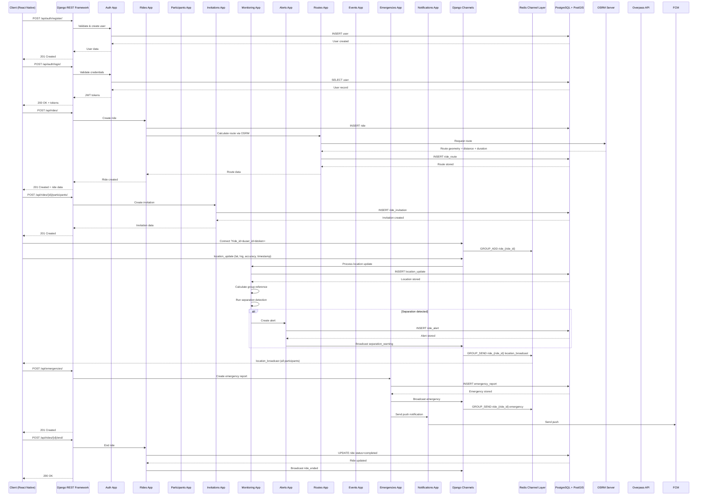
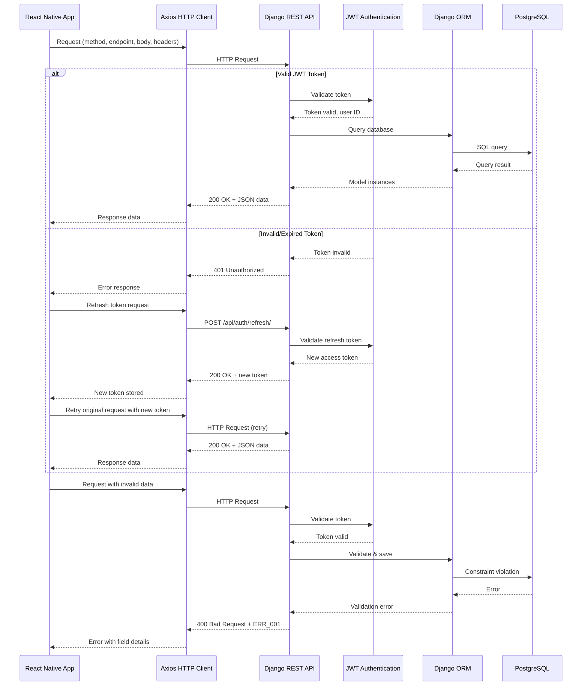
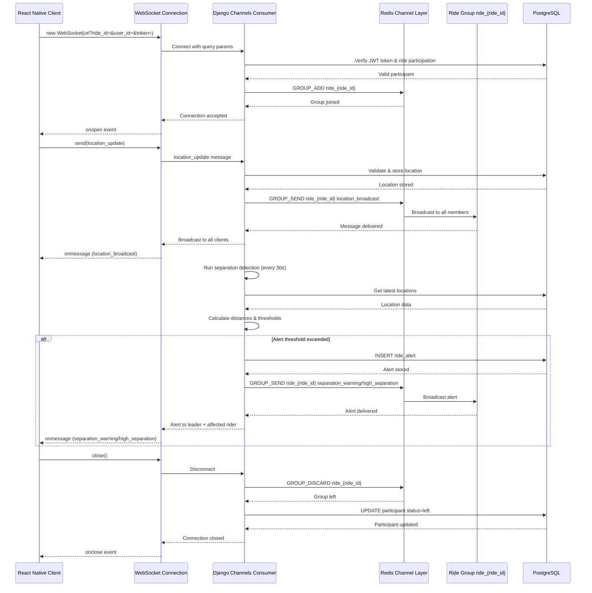
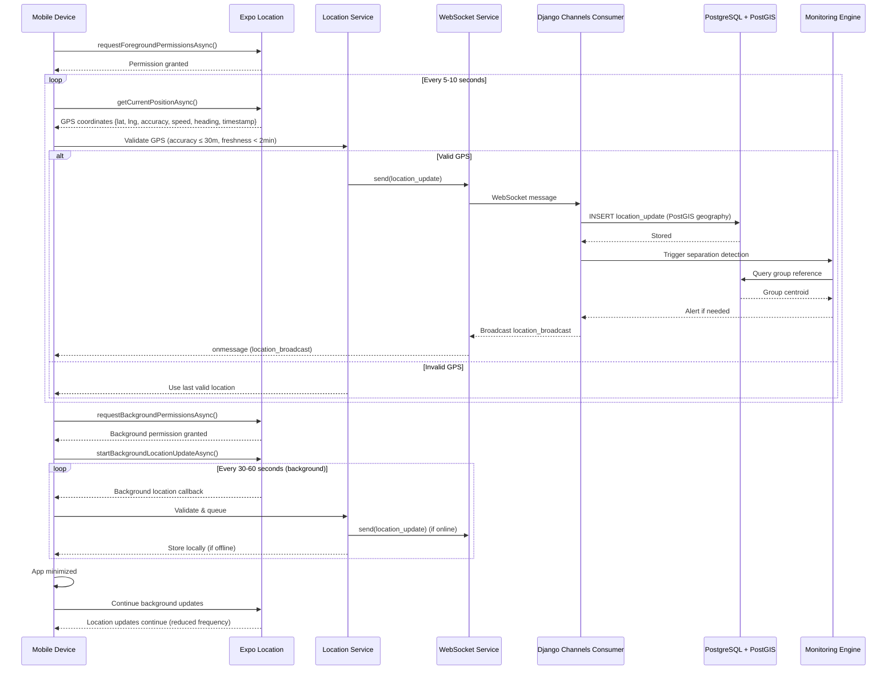
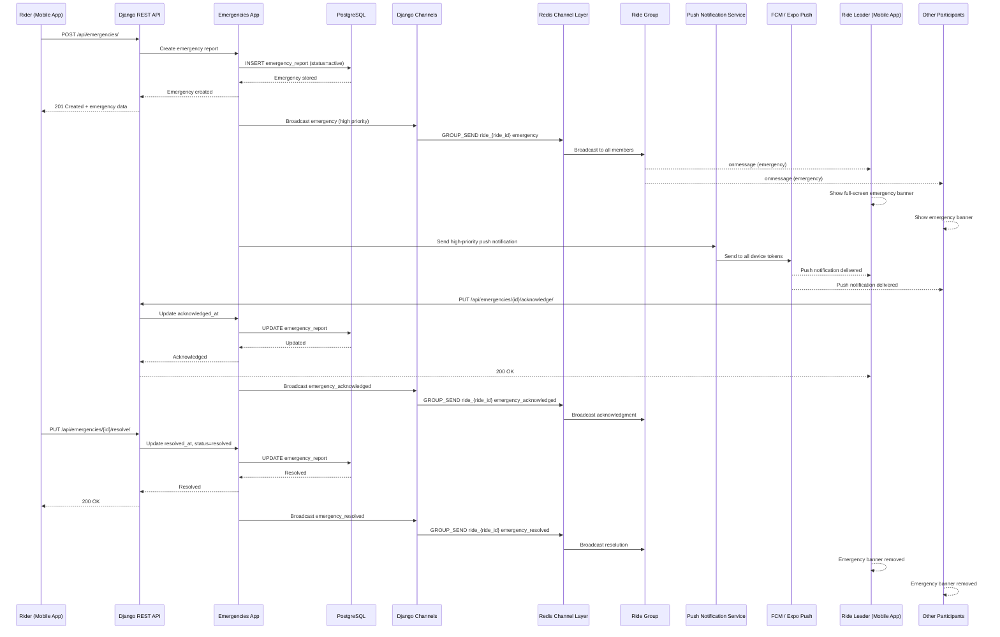
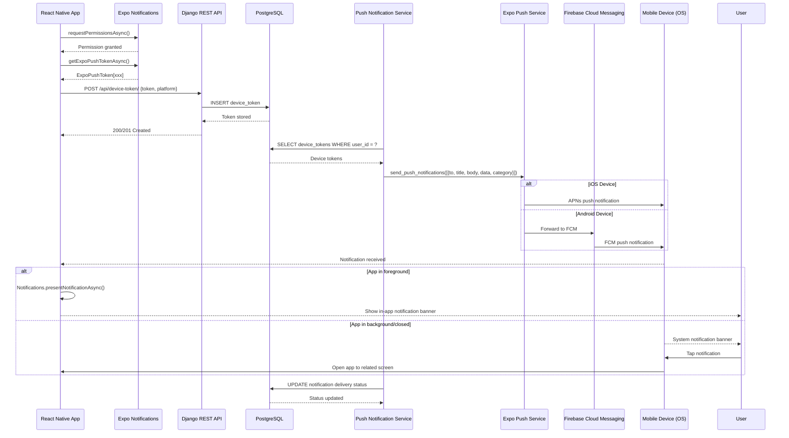
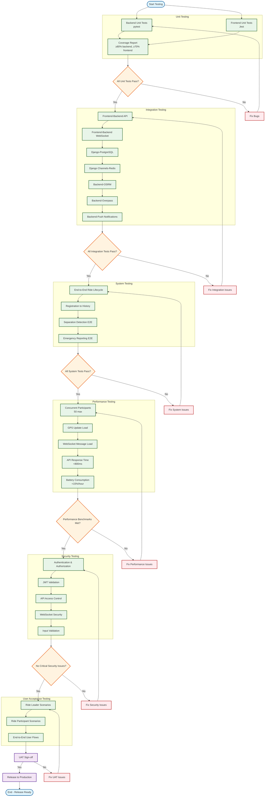

# RydLink - System Architecture and UML Diagrams

This document contains all required diagrams for the RydLink technical documentation, created using Mermaid syntax. These diagrams complement the backend, frontend, integration, and testing documentation files.

## Table of Contents
1. [Backend Architecture Diagram](#1-backend-architecture-diagram)
2. [Frontend Architecture Diagram](#2-frontend-architecture-diagram)
3. [Component Diagram](#3-component-diagram)
4. [Backend Module Interaction Diagram](#4-backend-module-interaction-diagram)
5. [Frontend–Backend Integration Diagram](#5-frontend-backend-integration-diagram)
6. [REST API Communication Flow](#6-rest-api-communication-flow)
7. [WebSocket Communication Flow](#7-websocket-communication-flow)
8. [GPS Location Tracking Sequence Diagram](#8-gps-location-tracking-sequence-diagram)
9. [Rider Separation Detection Activity Diagram](#9-rider-separation-detection-activity-diagram)
10. [Intelligent Regrouping Activity Diagram](#10-intelligent-regrouping-activity-diagram)
11. [Emergency Reporting Sequence Diagram](#11-emergency-reporting-sequence-diagram)
12. [Push Notification Sequence Diagram](#12-push-notification-sequence-diagram)
13. [Complete Ride Lifecycle Activity Diagram](#13-complete-ride-lifecycle-activity-diagram)
14. [Testing Workflow Diagram](#14-testing-workflow-diagram)

---

## 1. Backend Architecture Diagram

```mermaid
graph TD
    %% Client Layer
    subgraph Client [Client Layer]
        RN[React Native Mobile App]
        Expo[Expo SDK]
        Location[Expo Location]
        WS[WebSocket Client]
    end

    %% API Gateway
    subgraph API [API Gateway Layer]
        Nginx[Nginx Reverse Proxy]
        Daphne[Daphne ASGI Server]
    end

    %% Django Backend
    subgraph Django [Django Backend Layer]
        DRF[Django REST Framework]
        Auth[Authentication App]
        Rides[Rides App]
        Participants[Participants App]
        Invitations[Invitations App]
        Monitoring[Monitoring App]
        Alerts[Alerts App]
        Routes[Routes App]
        Events[Events App]
        Emergencies[Emergencies App]
        Notifications[Notifications App]
        History[History App]
    end

    %% Channels Layer
    subgraph Channels [Real-time Layer]
        Channels[Django Channels]
        Consumers[WebSocket Consumers]
        Groups[Ride Groups: ride_{ride_id}]
    end

    %% Database Layer
    subgraph Database [Database Layer]
        PostgreSQL[(PostgreSQL 14/15)]
        PostGIS[PostGIS 3.x Extension]
        pgcrypto[pgcrypto Extension]
    end

    %% Cache Layer
    subgraph Cache [Cache Layer]
        Redis[(Redis 6/7)]
    end

    %% External Services
    subgraph External [External Services]
        OSRM[OSRM Routing Server]
        Overpass[Overpass API]
        Nominatim[Nominatim Geocoding]
        OSM[OpenStreetMap Tiles]
        FCM[Firebase Cloud Messaging]
        ExpoPush[Expo Notifications]
    end

    %% Connections
    RN -->|REST API| Nginx
    RN -->|WebSocket| Daphne
    Nginx -->|HTTP| DRF
    Daphne -->|ASGI| Channels
    DRF --> Auth
    DRF --> Rides
    DRF --> Participants
    DRF --> Invitations
    DRF --> Monitoring
    DRF --> Alerts
    DRF --> Routes
    DRF --> Events
    DRF --> Emergencies
    DRF --> Notifications
    DRF --> History
    Channels --> Consumers
    Consumers --> Groups
    Auth --> PostgreSQL
    Rides --> PostgreSQL
    Participants --> PostgreSQL
    Invitations --> PostgreSQL
    Monitoring --> PostgreSQL
    Alerts --> PostgreSQL
    Routes --> PostgreSQL
    Events --> PostgreSQL
    Emergencies --> PostgreSQL
    Notifications --> PostgreSQL
    History --> PostgreSQL
    Channels --> Redis
    Monitoring --> OSRM
    Monitoring --> Overpass
    Notifications --> FCM
    Notifications --> ExpoPush
    PostgreSQL -.-> PostGIS
    PostgreSQL -.-> pgcrypto

    %% Styling
    classDef client fill:#e1f5fe,stroke:#01579b,stroke-width:2px
    classDef gateway fill:#fff3e0,stroke:#e65100,stroke-width:2px
    classDef backend fill:#e8f5e9,stroke:#1b5e20,stroke-width:2px
    classDef realtime fill:#f3e5f5,stroke:#4a148c,stroke-width:2px
    classDef database fill:#ffebee,stroke:#b71c1c,stroke-width:2px
    classDef cache fill:#f1f8e9,stroke:#33691e,stroke-width:2px
    classDef external fill:#eceff1,stroke:#37474f,stroke-width:2px

    class RN,Expo,Location,WS client
    class Nginx,Daphne gateway
    class DRF,Auth,Rides,Participants,Invitations,Monitoring,Alerts,Routes,Events,Emergencies,Notifications,History backend
    class Channels,Consumers,Groups realtime
    class PostgreSQL,PostGIS,pgcrypto database
    class Redis cache
    class OSRM,Overpass,Nominatim,OSM,FCM,ExpoPush external
```

---

## 2. Frontend Architecture Diagram

```mermaid
graph TD
    %% Entry Point
    Entry[App.js / index.js]

    %% Navigation Layer
    subgraph Navigation [Navigation Layer]
        Root[RootNavigator]
        AuthNav[AuthNavigator]
        MainNav[MainNavigator]
    end

    %% State Management
    subgraph State [State Management]
        AuthCtx[AuthContext]
        RideCtx[RideContext]
        NotifCtx[NotificationContext]
        Store[Redux Store]
    end

    %% Services Layer
    subgraph Services [Services Layer]
        API[API Service - Axios]
        WS[WebSocket Service]
        NotifSvc[Notifications Service]
        LocationSvc[Location Service]
    end

    %% Screens Layer
    subgraph Screens [Screens Layer]
        %% Auth Screens
        Reg[Register Screen]
        Log[Login Screen]

        %% Main Screens
        RC[Ride Creation Screen]
        RL[Ride Lobby Screen]
        LM[Live Map Screen]
        US[User Search Screen]
        PF[Profile Screen]
        RH[Ride History Screen]
        EM[Emergency Screen]
        NF[Notification Screen]
    end

    %% Components Layer
    subgraph Components [Components Layer]
        %% Common
        BTN[Button]
        INP[Input]
        LOAD[LoadingSpinner]
        TOAST[Error/Success Toast]

        %% Map Components
        MapC[Map Component]
        PartMarker[Participant Marker]
        RoutePoly[Route Polyline]
        MarkerCluster[Marker Cluster]

        %% Tracking Components
        SepInd[Separation Indicator]
        StatusBadge[Status Badge]
        RegroupBanner[Regrouping Banner]

        %% Event Components
        EventCard[Event Card]
        EmergBanner[Emergency Banner]
    end

    %% Native Modules
    subgraph Native [Native Modules - Expo]
        ExpoLoc[Expo Location]
        ExpoTask[Expo Task Manager]
        ExpoNotif[Expo Notifications]
        AsyncStorage[AsyncStorage]
    end

    %% Connections
    Entry --> Root
    Root --> AuthNav
    Root --> MainNav
    AuthNav --> Reg
    AuthNav --> Log
    MainNav --> RC
    MainNav --> RL
    MainNav --> LM
    MainNav --> US
    MainNav --> PF
    MainNav --> RH
    MainNav --> EM
    MainNav --> NF

    Root --> AuthCtx
    Root --> RideCtx
    Root --> NotifCtx
    Root --> Store

    AuthCtx --> API
    RideCtx --> API
    RideCtx --> WS
    NotifCtx --> NotifSvc

    Reg --> API
    Log --> API
    RC --> API
    RL --> API
    RL --> WS
    LM --> API
    LM --> WS
    US --> API
    PF --> API
    RH --> API
    EM --> API
    EM --> WS
    NF --> API

    BTN --> MapC
    MapC --> PartMarker
    MapC --> RoutePoly
    MapC --> MarkerCluster

    RL --> SepInd
    RL --> StatusBadge
    LM --> RegroupBanner
    LM --> EventCard
    LM --> EmergBanner

    ExpoLoc --> LocationSvc
    ExpoTask --> LocationSvc
    ExpoNotif --> NotifSvc
    AsyncStorage --> AuthCtx

    %% Styling
    classDef entry fill:#e1f5fe,stroke:#01579b,stroke-width:2px
    classDef nav fill:#fff3e0,stroke:#e65100,stroke-width:2px
    classDef state fill:#e8f5e9,stroke:#1b5e20,stroke-width:2px
    classDef svc fill:#f3e5f5,stroke:#4a148c,stroke-width:2px
    classDef screen fill:#e3f2fd,stroke:#1565c0,stroke-width:2px
    classDef comp fill:#fce4ec,stroke:#880e4f,stroke-width:2px
    classDef native fill:#f1f8e9,stroke:#33691e,stroke-width:2px

    class Entry entry
    class Root,AuthNav,MainNav nav
    class AuthCtx,RideCtx,NotifCtx,Store state
    class API,WS,NotifSvc,LocationSvc svc
    class Reg,Log,RC,RL,LM,US,PF,RH,EM,NF screen
    class BTN,INP,LOAD,TOAST,MapC,PartMarker,RoutePoly,MarkerCluster,SepInd,StatusBadge,RegroupBanner,EventCard,EmergBanner comp
    class ExpoLoc,ExpoTask,ExpoNotif,AsyncStorage native
```



---

## 3. Component Diagram

```mermaid
graph TD
    %% Frontend Components
    subgraph Frontend [React Native Frontend]
        direction TB
        
        subgraph Screens [Screens]
            RegScreen[RegisterScreen]
            LoginScreen[LoginScreen]
            RideCreateScreen[RideCreationScreen]
            RideLobbyScreen[RideLobbyScreen]
            LiveMapScreen[LiveMapScreen]
            UserSearchScreen[UserSearchScreen]
            ProfileScreen[ProfileScreen]
            RideHistoryScreen[RideHistoryScreen]
            EmergencyScreen[EmergencyScreen]
            NotificationScreen[NotificationScreen]
        end

        subgraph Components [Components]
            MapComponent[MapComponent]
            ParticipantMarker[ParticipantMarker]
            RoutePolyline[RoutePolyline]
            SeparationIndicator[SeparationIndicator]
            StatusBadge[StatusBadge]
            RegroupingBanner[RegroupingBanner]
            EventCard[EventCard]
            EmergencyBanner[EmergencyBanner]
        end

        subgraph Services [Services]
            APIService[APIService Axios]
            WebSocketService[WebSocketService]
            NotificationService[NotificationService]
            LocationService[LocationService]
        end

        subgraph Contexts [Contexts]
            AuthContext[AuthContext]
            RideContext[RideContext]
            NotificationContext[NotificationContext]
        end
    end

    %% Backend Components
    subgraph Backend [Django Backend]
        direction TB
        
        subgraph API [REST API]
            AuthViews[Auth Views]
            RideViews[Ride Views]
            ParticipantViews[Participant Views]
            InvitationViews[Invitation Views]
            AlertViews[Alert Views]
            MeetingPointViews[Meeting Point Views]
            EventViews[Event Views]
            EmergencyViews[Emergency Views]
            DeviceTokenViews[Device Token Views]
        end

        subgraph Consumers [WebSocket Consumers]
            LocationConsumer[LocationConsumer]
            AlertConsumer[AlertConsumer]
            InvitationConsumer[InvitationConsumer]
        end

        subgraph Models [Database Models]
            User[User]
            Ride[Ride]
            RideParticipant[RideParticipant]
            RideInvitation[RideInvitation]
            LocationUpdate[LocationUpdate]
            RideRoute[RideRoute]
            RideAlert[RideAlert]
            MeetingPointRec[MeetingPointRecommendation]
            RideEvent[RideEvent]
            EmergencyReport[EmergencyReport]
            DeviceToken[DeviceToken]
            Notification[Notification]
        end

        subgraph Services [Business Services]
            SeparationEngine[Separation Detection Engine]
            RegroupingEngine[Regrouping Engine]
            OSRMService[OSRM Service]
            OverpassService[Overpass Service]
            PushNotificationService[Push Notification Service]
        end
    end

    %% External
    subgraph External [External Services]
        OSRM[(OSRM Server)]
        Overpass[(Overpass API)]
        PostgreSQL[(PostgreSQL + PostGIS)]
        Redis[(Redis)]
        FCM[(Firebase Cloud Messaging)]
        ExpoPush[(Expo Notifications)]
        OSM[(OpenStreetMap Tiles)]
    end

    %% Frontend to Backend connections
    RegScreen --> APIService
    LoginScreen --> APIService
    RideCreateScreen --> APIService
    RideLobbyScreen --> APIService
    RideLobbyScreen --> WebSocketService
    LiveMapScreen --> APIService
    LiveMapScreen --> WebSocketService
    UserSearchScreen --> APIService
    ProfileScreen --> APIService
    RideHistoryScreen --> APIService
    EmergencyScreen --> APIService
    EmergencyScreen --> WebSocketService
    NotificationScreen --> APIService

    APIService --> AuthViews
    APIService --> RideViews
    APIService --> ParticipantViews
    APIService --> InvitationViews
    APIService --> AlertViews
    APIService --> MeetingPointViews
    APIService --> EventViews
    APIService --> EmergencyViews
    APIService --> DeviceTokenViews

    WebSocketService --> LocationConsumer
    WebSocketService --> AlertConsumer
    WebSocketService --> InvitationConsumer

    %% Backend to Database
    AuthViews --> User
    RideViews --> Ride
    ParticipantViews --> RideParticipant
    InvitationViews --> RideInvitation
    LocationConsumer --> LocationUpdate
    RideViews --> RideRoute
    AlertViews --> RideAlert
    MeetingPointViews --> MeetingPointRec
    EventViews --> RideEvent
    EmergencyViews --> EmergencyReport
    DeviceTokenViews --> DeviceToken
    APIService --> Notification

    %% Backend to External
    AuthViews --> PostgreSQL
    RideViews --> PostgreSQL
    ParticipantViews --> PostgreSQL
    InvitationViews --> PostgreSQL
    LocationConsumer --> PostgreSQL
    RideViews --> RideRoute
    AlertViews --> RideAlert
    MeetingPointViews --> MeetingPointRec
    EventViews --> RideEvent
    EmergencyViews --> EmergencyReport
    DeviceTokenViews --> DeviceToken

    SeparationEngine --> PostgreSQL
    RegroupingEngine --> PostgreSQL
    OSRMService --> OSRM
    OverpassService --> Overpass
    PushNotificationService --> FCM
    PushNotificationService --> ExpoPush

    Channels[Django Channels] --> Redis
    LocationConsumer --> Channels
    AlertConsumer --> Channels
    InvitationConsumer --> Channels

    %% Styling
    classDef frontend fill:#e1f5fe,stroke:#01579b,stroke-width:2px
    classDef backend fill:#e8f5e9,stroke:#1b5e20,stroke-width:2px
    classDef external fill:#eceff1,stroke:#37474f,stroke-width:2px

    class RegScreen,LoginScreen,RideCreateScreen,RideLobbyScreen,LiveMapScreen,UserSearchScreen,ProfileScreen,RideHistoryScreen,EmergencyScreen,NotificationScreen frontend
    class MapComponent,ParticipantMarker,RoutePolyline,SeparationIndicator,StatusBadge,RegroupingBanner,EventCard,EmergencyBanner frontend
    class APIService,WebSocketService,NotificationService,LocationService frontend
    class AuthContext,RideContext,NotificationContext frontend
    class AuthViews,RideViews,ParticipantViews,InvitationViews,AlertViews,MeetingPointViews,EventViews,EmergencyViews,DeviceTokenViews backend
    class LocationConsumer,AlertConsumer,InvitationConsumer backend
    class User,Ride,RideParticipant,RideInvitation,LocationUpdate,RideRoute,RideAlert,MeetingPointRec,RideEvent,EmergencyReport,DeviceToken,Notification backend
    class SeparationEngine,RegroupingEngine,OSRMService,OverpassService,PushNotificationService backend
    class OSRM,Overpass,PostgreSQL,Redis,FCM,ExpoPush,OSM external
```



---

## 4. Backend Module Interaction Diagram



---

## 5. Frontend–Backend Integration Diagram

```mermaid
graph LR
    %% Frontend
    subgraph FE [React Native Frontend]
        direction TB
        UI[UI Screens & Components]
        State[State Management - Redux/Context]
        API[API Service - Axios]
        WS[WebSocket Service]
        Notif[Expo Notifications]
        Loc[Expo Location]
    end

    %% Backend
    subgraph BE [Django Backend]
        direction TB
        DRF[Django REST Framework]
        Channels[Django Channels + Daphne]
        ORM[Django ORM]
        GIS[PostGIS Spatial Queries]
        MonEngine[Monitoring Engine]
        RegEngine[Regrouping Engine]
    end

    %% Database
    subgraph DB [(PostgreSQL + PostGIS)]
        direction TB
        Tables[12 Tables]
        Indexes[Spatial Indexes - GiST]
    end

    %% Cache
    subgraph Cache [(Redis)]
        ChannelLayer[Channel Layer]
    end

    %% External
    subgraph Ext [External Services]
        OSRM[OSRM Routing]
        Overpass[Overpass API]
        FCM[FCM / Expo Push]
    end

    %% Data flows
    UI <--> State
    State <--> API
    State <--> WS
    State <--> Notif
    State <--> Loc

    API <--> DRF
    WS <--> Channels
    Notif --> FCM
    Loc --> Loc

    DRF <--> ORM
    Channels <--> ChannelLayer
    ORM <--> Tables
    Tables <--> Indexes

    MonEngine <--> GIS
    RegEngine <--> GIS
    MonEngine --> OSRM
    RegEngine --> Overpass

    DB -.-> Tables
    Cache -.-> ChannelLayer

    %% Styling
    classDef frontend fill:#e1f5fe,stroke:#01579b,stroke-width:2px
    classDef backend fill:#e8f5e9,stroke:#1b5e20,stroke-width:2px
    classDef database fill:#ffebee,stroke:#b71c1c,stroke-width:2px
    classDef cache fill:#f1f8e9,stroke:#33691e,stroke-width:2px
    classDef external fill:#eceff1,stroke:#37474f,stroke-width:2px

    class UI,State,API,WS,Notif,Loc frontend
    class DRF,Channels,ORM,GIS,MonEngine,RegEngine backend
    class Tables,Indexes database
    class ChannelLayer cache
    class OSRM,Overpass,FCM external
```

---

## 6. REST API Communication Flow



---

## 7. WebSocket Communication Flow



---

## 8. GPS Location Tracking Sequence Diagram



---

## 9. Rider Separation Detection Activity Diagram

```mermaid
activityDiagram
    start
    
    note right: Separation Detection Engine<br/>Runs every 30 seconds
    
    :Get all active participants in ride;
    :Get latest location for each participant;
    
    for each participant
        :Validate GPS accuracy ≤ 30m;
        
        if accuracy > 30m then
            :Skip participant, use last valid location;
        else
            :Validate location freshness < 2 minutes;
            
            if location stale then
                :Skip participant in evaluation;
            else
                :Calculate distance from group reference position;
                
                if distance ≤ 300m then
                    :Status = normal;
                    :Reset timer;
                    if previous status != normal then
                        :Generate regrouped alert;
                    end if
                elseif distance ≤ 500m then
                    :Status = monitoring;
                    :Start/pause timer;
                elseif distance ≤ 1000m then
                    :Status = separation_warning;
                    :Start 60-second timer;
                    
                    if timer ≥ 60s then
                        :Generate separation_warning alert;
                        :Reset timer to prevent duplicates;
                    end if
                else
                    :Status = high_separation;
                    :Start 30-second timer;
                    
                    if timer ≥ 30s then
                        :Generate high_separation alert;
                        :Reset timer to prevent duplicates;
                    end if
                end if
                
                :Update participant separation status in DB;
            end if
        end if
    end for
    
    :Broadcast alerts via WebSocket;
    :Broadcast location_broadcast to all participants;
    stop
```

---

## 10. Intelligent Regrouping Activity Diagram

```mermaid
activityDiagram
    start
    
    note left: Intelligent Regrouping Algorithm<br/>Rule-based, no ML
    
    :Separation warning or high separation triggered;
    :Rider returns within 300m OR Leader initiates;
    
    :Calculate group reference position (centroid);
    
    :Discover candidate POIs via Overpass API;
    :Filter by type: fuel, restaurant, parking;
    :Search radius: 5 km from centroid;
    
    for each candidate POI
        for each participant
            :Calculate OSRM route travel time;
            
            if no valid route then
                :Skip candidate for this participant;
            end if
        end for
        
        :Calculate worst-case ETA (max across participants);
        :Calculate average ETA;
        :Apply suitability filter (ETA ≤ 30 min);
        
        if suitable then
            :Add to ranked candidates;
        end if
    end for
    
    :Sort candidates by worst-case ETA (ascending);
    :Sort by average ETA (secondary);
    
    :Present top 3 recommendations to Ride Leader;
    
    :Leader approves or rejects;
    
    if approved then
        :Update recommendation status = approved;
        :Broadcast meeting_point_approved via WebSocket;
        :Show meeting point on map to all participants;
        :Update ETA for each participant;
        
        :Participant navigates to meeting point;
        
        :Upon arrival within 300m for 30s;
        :Auto-resolve separation alert;
        :Broadcast regrouped notification;
    else
        :Recommendation rejected;
        :Leader may request more options;
    end if
    
    stop
```

---

## 11. Emergency Reporting Sequence Diagram



---

## 12. Push Notification Sequence Diagram



---

## 13. Complete Ride Lifecycle Activity Diagram

```mermaid
activityDiagram
    start
    
    note top: Complete Ride Lifecycle<br/>From creation to history
    
    :User registers and logs in;
    
    :Ride Leader creates ride (start, dest, departure time);
    :Ride status = planned;
    :Route calculated via OSRM;
    
    :Leader invites participants;
    :Invitation status = pending (24h expiry);
    
    :Participants accept/reject invitations;
    :Accepted: participant added to ride;
    :Rejected: invitation closed;
    
    :Ride lobby - participants join;
    :Participant status = joined;
    
    :Leader starts ride;
    :Ride status = active;
    :WebSocket connection established;
    :Location tracking starts (foreground/background);
    
    loop During active ride
        :Participants share GPS locations;
        :Location broadcast to all participants;
        :Separation detection every 30s;
        
        if separation detected then
            :Generate separation warning/high separation alert;
            :Notify leader + affected rider;
        end if
        
        if regrouping needed then
            :Generate meeting point recommendations;
            :Leader approves meeting point;
            :Share with all participants;
        end if
        
        if ride event created then
            :Broadcast ride event to all participants;
        end if
        
        if emergency reported then
            :Broadcast emergency (high priority);
            :Send push notification;
            :Acknowledge and resolve;
        end if
    end loop
    
    :Leader ends ride;
    :Ride status = completed;
    :WebSocket connections closed;
    :Location tracking stopped;
    
    :Archive ride to history;
    :Ride data retained per policy (90 days for locations);
    
    :Participants can view ride history;
    stop
```

---

## 14. Testing Workflow Diagram



---