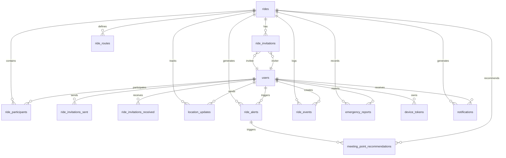

# Detailed Database Design Document (DDD)

**Project:** RydLink – Intelligent Group Ride Coordination and Safety System  
**Database:** PostgreSQL 14/15 + PostGIS 3.x  
**ORM:** Django

---

## DDD-1: Complete Entity Relationship Diagram (Mermaid)



---

## DDD-2: Complete Table Specifications

| # | Table | Purpose | Row Estimate (Active) |
|---|-------|---------|----------------------|
| 1 | `users` | User accounts | 10K–1M |
| 2 | `rides` | Ride definitions | 1K–100K |
| 3 | `ride_participants` | Ride membership (role per ride) | 10K–5M |
| 4 | `ride_invitations` | Invitation lifecycle | 5K–500K |
| 5 | `location_updates` | GPS points (PostGIS geography) | High volume, pruned |
| 6 | `ride_routes` | Route polylines (PostGIS geometry) | 1 per ride |
| 7 | `ride_alerts` | Monitoring alerts | 1K–1M |
| 8 | `meeting_point_recommendations` | Regrouping candidates | 1K–500K |
| 9 | `ride_events` | Fuel/food/rest/breakdown events | 5K–1M |
| 10 | `emergency_reports` | Emergency/breakdown reports | Low volume |
| 11 | `device_tokens` | Push notification tokens | 1 per device per user |
| 12 | `notifications` | Notification history (optional) | 10K–5M |

---

## DDD-3: Field-by-Field Data Dictionary

### Table: users

| Column | Type | Nullable | Default | Constraint | Description |
|--------|------|----------|---------|------------|-------------|
| id | UUID | No | gen_random_uuid() | PK | Primary key |
| email | VARCHAR(255) | No | — | UNIQUE | User email |
| password_hash | VARCHAR(255) | No | — | — | bcrypt/Argon2 hash |
| phone | VARCHAR(20) | Yes | — | — | E.164 format |
| first_name | VARCHAR(100) | Yes | — | — | |
| last_name | VARCHAR(100) | Yes | — | — | |
| profile_picture_url | TEXT | Yes | — | — | |
| emergency_contact_name | VARCHAR(100) | Yes | — | — | |
| emergency_contact_phone | VARCHAR(20) | Yes | — | — | |
| is_active | BOOLEAN | No | TRUE | — | Account active |
| email_verified | BOOLEAN | No | FALSE | — | |
| created_at | TIMESTAMPTZ | No | now() | — | |
| updated_at | TIMESTAMPTZ | No | now() | — | |

**Indexes:** `users_email_idx` (UNIQUE), `users_created_at_idx`

### Table: rides

| Column | Type | Nullable | Default | Constraint | Description |
|--------|------|----------|---------|------------|-------------|
| id | UUID | No | gen_random_uuid() | PK | Primary key |
| name | VARCHAR(200) | No | — | — | Ride name |
| leader_id | UUID | No | — | FK → users.id | Ride leader |
| start_lat | DOUBLE PRECISION | No | — | CHECK -90 to 90 | Start latitude |
| start_lng | DOUBLE PRECISION | No | — | CHECK -180 to 180 | Start longitude |
| start_address | VARCHAR(500) | Yes | — | — | Start address |
| dest_lat | DOUBLE PRECISION | No | — | CHECK -90 to 90 | Destination latitude |
| dest_lng | DOUBLE PRECISION | No | — | CHECK -180 to 180 | Destination longitude |
| dest_address | VARCHAR(500) | Yes | — | — | Destination address |
| departure_time | TIMESTAMPTZ | Yes | — | — | Planned departure |
| status | VARCHAR(20) | No | 'planned' | CHECK planned/active/completed/cancelled | Ride status |
| created_at | TIMESTAMPTZ | No | now() | — | |
| started_at | TIMESTAMPTZ | Yes | — | — | |
| ended_at | TIMESTAMPTZ | Yes | — | — | |

**Indexes:** `rides_leader_id_idx`, `rides_status_idx`, `rides_created_at_idx`

**Foreign Key:** `rides_leader_id_fkey` → users(id) ON DELETE PROTECT

**Cascading:** ON DELETE CASCADE to ride_participants, ride_invitations, ride_routes, ride_alerts, meeting_point_recommendations, ride_events, emergency_reports

### Table: ride_participants

| Column | Type | Nullable | Default | Constraint | Description |
|--------|------|----------|---------|------------|-------------|
| id | UUID | No | gen_random_uuid() | PK | |
| ride_id | UUID | No | — | FK → rides.id | |
| user_id | UUID | No | — | FK → users.id | |
| role | VARCHAR(20) | No | 'participant' | CHECK leader/participant | Ride-specific role |
| status | VARCHAR(20) | No | 'joined' | CHECK joined/left | Participation status |
| joined_at | TIMESTAMPTZ | No | now() | — | |
| left_at | TIMESTAMPTZ | Yes | — | — | |
| is_active | BOOLEAN | No | TRUE | — | Currently in ride |

**Indexes:** `rp_ride_id_idx`, `rp_user_id_idx`, `rp_ride_user_unique_idx` (UNIQUE on ride_id + user_id)

**Foreign Keys:** ON DELETE CASCADE both

### Table: ride_invitations

| Column | Type | Nullable | Default | Constraint | Description |
|--------|------|----------|---------|------------|-------------|
| id | UUID | No | gen_random_uuid() | PK | |
| ride_id | UUID | No | — | FK → rides.id | |
| inviter_id | UUID | No | — | FK → users.id | Leader who sent |
| invitee_id | UUID | No | — | FK → users.id | User invited |
| token | UUID | No | gen_random_uuid() | UNIQUE | Single-use token |
| status | VARCHAR(20) | No | 'pending' | CHECK pending/accepted/rejected/expired | |
| expires_at | TIMESTAMPTZ | No | — | — | 24h from creation |
| created_at | TIMESTAMPTZ | No | now() | — | |
| responded_at | TIMESTAMPTZ | Yes | — | — | |

**Indexes:** `ri_token_idx` (UNIQUE), `ri_ride_id_idx`, `ri_invitee_id_idx`, `ri_expires_at_idx`

**Foreign Keys:** ON DELETE CASCADE

### Table: location_updates

| Column | Type | Nullable | Default | Constraint | Description |
|--------|------|----------|---------|------------|-------------|
| id | UUID | No | gen_random_uuid() | PK | |
| ride_id | UUID | No | — | FK → rides.id | |
| user_id | UUID | No | — | FK → users.id | |
| location | geography(Point,4326) | No | — | — | PostGIS point |
| accuracy | DOUBLE PRECISION | Yes | — | meters | GPS accuracy |
| speed | DOUBLE PRECISION | Yes | — | m/s | |
| heading | DOUBLE PRECISION | Yes | — | degrees | |
| recorded_at | TIMESTAMPTZ | No | — | — | Device timestamp |
| server_received_at | TIMESTAMPTZ | No | now() | — | |

**Indexes:** `lu_ride_user_time_idx` (ride_id, user_id, recorded_at DESC), `lu_location_gist` (GIST on location)

**Retention:** Latest location per user per ride kept; older records purged per retention policy

### Table: ride_routes

| Column | Type | Nullable | Default | Constraint | Description |
|--------|------|----------|---------|------------|-------------|
| id | UUID | No | gen_random_uuid() | PK | |
| ride_id | UUID | No | — | UNIQUE, FK → rides.id | One route per ride |
| geometry | geometry(LineString,4326) | No | — | — | Route polyline |
| distance_m | DOUBLE PRECISION | No | — | meters | |
| duration_s | INTEGER | No | — | seconds | |
| created_at | TIMESTAMPTZ | No | now() | — | |

**Indexes:** `rr_geometry_gist` (GIST on geometry)

**Foreign Key:** ON DELETE CASCADE

### Table: ride_alerts

| Column | Type | Nullable | Default | Constraint | Description |
|--------|------|----------|---------|------------|-------------|
| id | UUID | No | gen_random_uuid() | PK | |
| ride_id | UUID | No | — | FK → rides.id | |
| user_id | UUID | Yes | — | FK → users.id | Participant involved |
| type | VARCHAR(20) | No | — | CHECK separation/deviation/stationary | |
| message | TEXT | Yes | — | — | Alert message |
| location_lat | DOUBLE PRECISION | Yes | — | — | Alert location |
| location_lng | DOUBLE PRECISION | Yes | — | — | |
| status | VARCHAR(20) | No | 'active' | CHECK active/resolved | |
| created_at | TIMESTAMPTZ | No | now() | — | |
| resolved_at | TIMESTAMPTZ | Yes | — | — | |
| resolved_by | UUID | Yes | — | FK → users.id | |

**Indexes:** `ra_ride_id_idx`, `ra_status_idx`, `ra_type_idx`

**Foreign Keys:** ON DELETE CASCADE

### Table: meeting_point_recommendations

| Column | Type | Nullable | Default | Constraint | Description |
|--------|------|----------|---------|------------|-------------|
| id | UUID | No | gen_random_uuid() | PK | |
| ride_id | UUID | No | — | FK → rides.id | |
| alert_id | UUID | Yes | — | FK → ride_alerts.id | Source alert |
| name | VARCHAR(200) | No | — | — | POI name |
| type | VARCHAR(50) | No | — | — | fuel/restaurant/parking |
| lat | DOUBLE PRECISION | No | — | CHECK -90 to 90 | |
| lng | DOUBLE PRECISION | No | — | CHECK -180 to 180 | |
| address | VARCHAR(500) | Yes | — | — | |
| rank_score | DOUBLE PRECISION | No | — | — | Ranking score |
| max_eta_s | INTEGER | No | — | — | Worst-case ETA seconds |
| status | VARCHAR(20) | No | 'pending' | CHECK pending/approved/rejected/expired | |
| created_at | TIMESTAMPTZ | No | now() | — | |
| expires_at | TIMESTAMPTZ | No | — | — | |
| approved_by | UUID | Yes | — | FK → users.id | Leader |
| approved_at | TIMESTAMPTZ | Yes | — | — | |

**Indexes:** `mpr_ride_id_idx`, `mpr_status_idx`, `mpr_expires_at_idx`

**Foreign Keys:** ON DELETE CASCADE

### Table: ride_events

| Column | Type | Nullable | Default | Constraint | Description |
|--------|------|----------|---------|------------|-------------|
| id | UUID | No | gen_random_uuid() | PK | |
| ride_id | UUID | No | — | FK → rides.id | |
| user_id | UUID | No | — | FK → users.id | Creator |
| type | VARCHAR(30) | No | — | CHECK fuel/food/rest/breakdown/other | |
| location_lat | DOUBLE PRECISION | No | — | — | |
| location_lng | DOUBLE PRECISION | No | — | — | |
| address | VARCHAR(500) | Yes | — | — | |
| note | TEXT | Yes | — | — | |
| planned_time | TIMESTAMPTZ | Yes | — | — | |
| status | VARCHAR(20) | No | 'planned' | CHECK planned/completed/cancelled | |
| created_at | TIMESTAMPTZ | No | now() | — | |
| completed_at | TIMESTAMPTZ | Yes | — | — | |

**Indexes:** `re_ride_id_idx`, `re_type_idx`, `re_status_idx`

**Foreign Keys:** ON DELETE CASCADE

### Table: emergency_reports

| Column | Type | Nullable | Default | Constraint | Description |
|--------|------|----------|---------|------------|-------------|
| id | UUID | No | gen_random_uuid() | PK | |
| ride_id | UUID | No | — | FK → rides.id | |
| user_id | UUID | No | — | FK → users.id | Reporter |
| type | VARCHAR(20) | No | — | CHECK breakdown/emergency | |
| severity | VARCHAR(10) | No | 'high' | CHECK low/medium/high/critical | |
| description | TEXT | Yes | — | — | |
| location_lat | DOUBLE PRECISION | No | — | — | |
| location_lng | DOUBLE PRECISION | No | — | — | |
| status | VARCHAR(20) | No | 'active' | CHECK active/acknowledged/resolved/false_alarm | |
| created_at | TIMESTAMPTZ | No | now() | — | |
| acknowledged_at | TIMESTAMPTZ | Yes | — | — | |
| resolved_at | TIMESTAMPTZ | Yes | — | — | |
| resolved_by | UUID | Yes | — | FK → users.id | |

**Indexes:** `er_ride_id_idx`, `er_status_idx`, `er_severity_idx`

**Foreign Keys:** ON DELETE CASCADE

### Table: device_tokens

| Column | Type | Nullable | Default | Constraint | Description |
|--------|------|----------|---------|------------|-------------|
| id | UUID | No | gen_random_uuid() | PK | |
| user_id | UUID | No | — | FK → users.id | |
| token | TEXT | No | UNIQUE | — | FCM/Expo token |
| platform | VARCHAR(10) | No | — | CHECK ios/android | |
| created_at | TIMESTAMPTZ | No | now() | — | |
| last_used_at | TIMESTAMPTZ | Yes | — | — | |

**Indexes:** `dt_user_id_idx`, `dt_token_idx` (UNIQUE)

**Foreign Key:** ON DELETE CASCADE

### Table: notifications (optional — notification history)

| Column | Type | Nullable | Default | Constraint | Description |
|--------|------|----------|---------|------------|-------------|
| id | UUID | No | gen_random_uuid() | PK | |
| user_id | UUID | No | — | FK → users.id | |
| ride_id | UUID | Yes | — | FK → rides.id | |
| type | VARCHAR(30) | No | — | — | |
| title | VARCHAR(200) | No | — | — | |
| body | TEXT | No | — | — | |
| data | JSONB | Yes | — | — | Extra payload |
| read_at | TIMESTAMPTZ | Yes | — | — | |
| created_at | TIMESTAMPTZ | No | now() | — | |

**Indexes:** `n_user_id_idx`, `n_created_at_idx`

---

## DDD-4: Primary Keys

All tables use `UUID` primary key with `gen_random_uuid()` default (requires `pgcrypto` extension).

---

## DDD-5: Foreign Keys

| FK Column | References | On Delete |
|-----------|-----------|-----------|
| ride_participants.ride_id | rides.id | CASCADE |
| ride_participants.user_id | users.id | CASCADE |
| ride_invitations.ride_id | rides.id | CASCADE |
| ride_invitations.inviter_id | users.id | CASCADE |
| ride_invitations.invitee_id | users.id | CASCADE |
| location_updates.ride_id | rides.id | CASCADE |
| location_updates.user_id | users.id | CASCADE |
| ride_routes.ride_id | rides.id | CASCADE |
| ride_alerts.ride_id | rides.id | CASCADE |
| ride_alerts.user_id | users.id | CASCADE |
| ride_alerts.resolved_by | users.id | SET NULL |
| meeting_point_recommendations.ride_id | rides.id | CASCADE |
| meeting_point_recommendations.alert_id | ride_alerts.id | CASCADE |
| meeting_point_recommendations.approved_by | users.id | SET NULL |
| ride_events.ride_id | rides.id | CASCADE |
| ride_events.user_id | users.id | CASCADE |
| emergency_reports.ride_id | rides.id | CASCADE |
| emergency_reports.user_id | users.id | CASCADE |
| emergency_reports.resolved_by | users.id | SET NULL |
| device_tokens.user_id | users.id | CASCADE |
| notifications.user_id | users.id | CASCADE |
| notifications.ride_id | rides.id | CASCADE |

---

## DDD-6: Unique Constraints

| Table | Constraint | Columns |
|-------|-----------|---------|
| users | users_email_key | email |
| ride_participants | ride_participants_ride_user_key | ride_id, user_id |
| ride_invitations | ride_invitations_token_key | token |
| device_tokens | device_tokens_token_key | token |
| ride_routes | ride_routes_ride_id_key | ride_id |

---

## DDD-7: Check Constraints

| Table | Constraint | Condition |
|-------|-----------|-----------|
| rides | rides_status_check | status IN ('planned','active','completed','cancelled') |
| rides | rides_start_lat_check | start_lat BETWEEN -90 AND 90 |
| rides | rides_start_lng_check | start_lng BETWEEN -180 AND 180 |
| rides | rides_dest_lat_check | dest_lat BETWEEN -90 AND 90 |
| rides | rides_dest_lng_check | dest_lng BETWEEN -180 AND 180 |
| ride_participants | rp_role_check | role IN ('leader','participant') |
| ride_participants | rp_status_check | status IN ('joined','left') |
| ride_invitations | ri_status_check | status IN ('pending','accepted','rejected','expired') |
| ride_alerts | ra_type_check | type IN ('separation_warning','high_separation','regrouped','deviation','stationary') |
| ride_alerts | ra_severity_check | severity IN ('warning','high','info') |
| ride_alerts | ra_status_check | status IN ('active','resolved') |
| ride_participants | rp_separation_status_check | separation_status IN ('normal','monitoring','separation_warning','high_separation','regrouped') |
| meeting_point_recommendations | mpr_status_check | status IN ('pending','approved','rejected','expired') |
| ride_events | re_type_check | type IN ('fuel','food','rest','breakdown','other') |
| ride_events | re_status_check | status IN ('planned','completed','cancelled') |
| emergency_reports | er_type_check | type IN ('breakdown','emergency') |
| emergency_reports | er_severity_check | severity IN ('low','medium','high','critical') |
| emergency_reports | er_status_check | status IN ('active','acknowledged','resolved','false_alarm') |
| device_tokens | dt_platform_check | platform IN ('ios','android') |

---

## DDD-8: Indexes

| Table | Index Name | Columns | Type |
|-------|-----------|---------|------|
| users | users_email_idx | email | UNIQUE B-tree |
| users | users_created_at_idx | created_at | B-tree |
| rides | rides_leader_id_idx | leader_id | B-tree |
| rides | rides_status_idx | status | B-tree |
| rides | rides_created_at_idx | created_at | B-tree |
| ride_participants | rp_ride_id_idx | ride_id | B-tree |
| ride_participants | rp_user_id_idx | user_id | B-tree |
| ride_invitations | ri_ride_id_idx | ride_id | B-tree |
| ride_invitations | ri_invitee_id_idx | invitee_id | B-tree |
| ride_invitations | ri_expires_at_idx | expires_at | B-tree |
| location_updates | lu_ride_user_time_idx | ride_id, user_id, recorded_at DESC | B-tree |
| location_updates | lu_location_gist | location | GiST (spatial) |
| ride_routes | rr_geometry_gist | geometry | GiST (spatial) |
| ride_alerts | ra_ride_id_idx | ride_id | B-tree |
| ride_alerts | ra_status_idx | status | B-tree |
| meeting_point_recommendations | mpr_ride_id_idx | ride_id | B-tree |
| meeting_point_recommendations | mpr_expires_at_idx | expires_at | B-tree |
| ride_events | re_ride_id_idx | ride_id | B-tree |
| emergency_reports | er_ride_id_idx | ride_id | B-tree |
| device_tokens | dt_user_id_idx | user_id | B-tree |
| notifications | n_user_id_idx | user_id | B-tree |
| notifications | n_created_at_idx | created_at | B-tree |

---

## DDD-9: PostGIS Geography Fields

| Table | Field | Type | SRID | Purpose |
|-------|-------|------|------|---------|
| location_updates | location | geography(Point) | 4326 | Participant GPS point |
| ride_routes | geometry | geometry(LineString) | 4326 | Planned route polyline |

---

## DDD-10: Spatial Indexes

- `lu_location_gist` on `location_updates.location` (GiST)
- `rr_geometry_gist` on `ride_routes.geometry` (GiST)

---

## DDD-11: Normalization

- **1NF:** Atomic values, no repeating groups
- **2NF:** All non-key attributes depend on full primary key
- **3NF:** No transitive dependencies
- No denormalization for MVP; read models can be added later if performance requires

---

## DDD-12: Data Retention Strategy

| Data | Active Ride | Completed Ride | Deletion |
|------|------------|----------------|----------|
| Location updates | Latest per user per ride | 90 days | Scheduled job |
| Ride metadata | — | Indefinite | Manual archive |
| Alerts, events, emergencies | — | 90 days | Scheduled job |
| Invitations | 24h expiry | — | Status update |
| Device tokens | Until logout/revoke | — | On invalid token |

---

## DDD-13: Sample Records

**users:**
```json
{
  "id": "550e8400-e29b-41d4-a716-446655440000",
  "email": "alice@example.com",
  "password_hash": "$2b$12$...",
  "phone": "+1234567890",
  "first_name": "Alice",
  "last_name": "Smith",
  "is_active": true,
  "email_verified": true
}
```

**rides:**
```json
{
  "id": "660e8400-e29b-41d4-a716-446655440001",
  "name": "Weekend Trip",
  "leader_id": "550e8400-e29b-41d4-a716-446655440000",
  "start_lat": 40.7128,
  "start_lng": -74.0060,
  "dest_lat": 40.7589,
  "dest_lng": -73.9851,
  "status": "planned"
}
```

**location_updates (PostGIS):**
```sql
INSERT INTO location_updates (ride_id, user_id, location, accuracy, speed, recorded_at)
VALUES (
  '660e8400-...',
  '550e8400-...',
  ST_SetSRID(ST_MakePoint(-74.0060, 40.7128), 4326)::geography,
  5.0, 12.5, NOW()
);
```

**ride_routes:**
```json
{
  "id": "880e8400-...",
  "ride_id": "660e8400-...",
  "geometry": { "type": "LineString", "coordinates": [[-74.0060, 40.7128], [-73.9851, 40.7589]] },
  "distance_m": 4500,
  "duration_s": 600
}
```

**ride_alerts:**
```json
{
  "id": "990e8400-...",
  "ride_id": "660e8400-...",
  "user_id": "550e8400-...",
  "type": "separation",
  "message": "Alice has separated from the group by 500m",
  "status": "active"
}
```

---

## DDD-14: Django Model Mapping

| Table | Django Model | GIS Field |
|-------|-------------|-----------|
| users | User | — |
| rides | Ride | — |
| ride_participants | RideParticipant | — |
| ride_invitations | RideInvitation | — |
| location_updates | LocationUpdate | PointField(geography=True) |
| ride_routes | RideRoute | LineStringField |
| ride_alerts | RideAlert | — |
| meeting_point_recommendations | MeetingPointRecommendation | — |
| ride_events | RideEvent | — |
| emergency_reports | EmergencyReport | — |
| device_tokens | DeviceToken | — |
| notifications | Notification | — |

PostGIS fields use `django.contrib.gis.db.models.fields.PointField(geography=True)` and `LineStringField`.

---

## DDD-15: Migration Considerations

1. Enable `pgcrypto` extension: `CREATE EXTENSION IF NOT EXISTS pgcrypto;`
2. Enable `postgis` extension: `CREATE EXTENSION IF NOT EXISTS postgis;`
3. Initial migration creates all 12 tables
4. Spatial indexes via `django.contrib.gis.db.models.indexes.GistIndex`
5. Data retention via Django management command (cron/celery beat)
6. No destructive migrations after production; use additive changes

---

**End of Detailed Database Design Document.**
