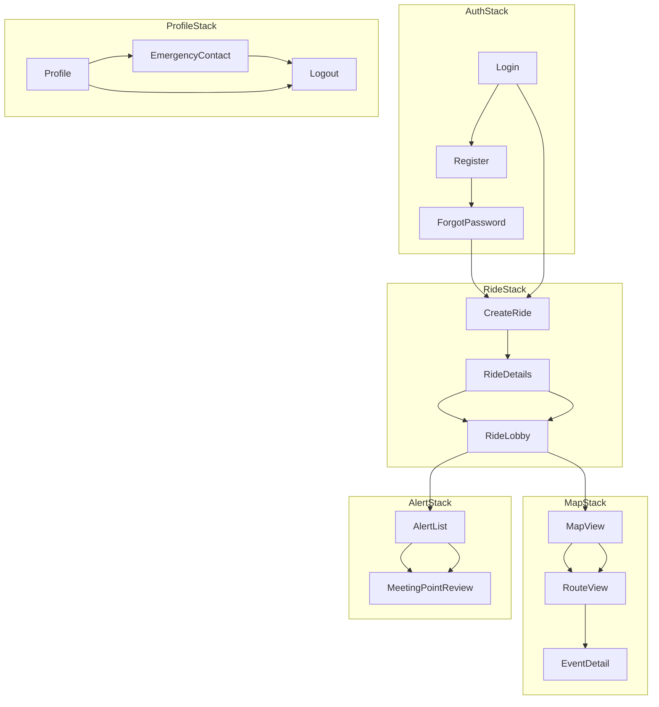
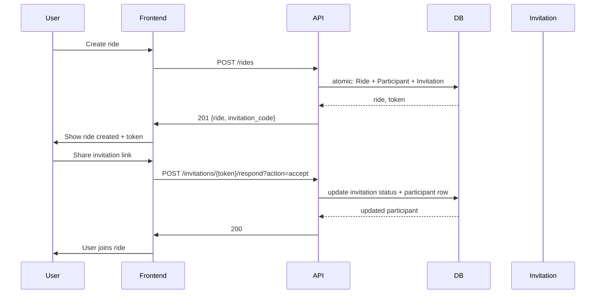
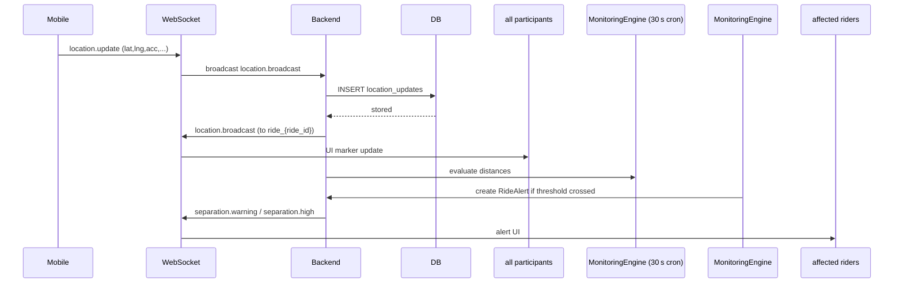

# RydLink – Module‑by‑Module Technical Design

## Document Control
| Item | Detail |
|------|--------|
| **Author** | RydLink Design Team |
| **Version** | 1.0.0 – 2026‑11‑21 |
| **Status** | Draft (pending product‑owner ratification of open decisions) |
| **Scope** | Separate technical documentation file covering the module‑by‑module design plan generated in Plan mode, consolidated into a canonical, professional format suitable for implementation. |
| **Source of Truth** | Sections 01‑20, database‑design‑document.md, technical‑specification.md, master prompt output. |
| **Canonical Decisions** | REST: S09 API catalogue. WebSocket: S10 protocol. RBAC: S03. DB schema: 12‑table DDD model with separation columns added. Thresholds, timers, and alert logic from S02/S08/S12 (corrected). Frontend screens: S13. Services and layering: S06/S17. Error envelope: S09 canonical. These choices supersede any contradictory material from the earlier chat output and are logged in §§15‑16. |
| **Revision History** | 1.0.0 – initial release; 1.0.1 – typo fixes for constants REGREPING\_DISTANCE\_M and REGREPING\_CONFIRMATION\_S. |

---

## 1. Technical Design Overview
1. **Product purpose** – Intelligent group‑ride coordination and safety system for separate‑vehicle groups (cars, bikes, etc.). RydLink **complements** (not replaces) Google Maps / Waze; **no turn‑by‑turn navigation** inside the app.
2. **Domain** – Users form rides; each ride has a leader, participants, live location broadcast, separation monitoring with configurable distance‑and‑time thresholds, regrouping recommendations, ride events (fuel, food, rest, breakdown), and emergency reports.
3. **Non‑goals (out of MVP scope)** – WhatsApp/SMS integration, machine‑learning‑based predictions, OBD‑II hardware, payments, full turn‑by‑turn navigation, multi‑modal routing beyond cars.
4. **Architecture diagram** (Mermaid)

```mermaid
flowchart TB
    subgraph Frontend
        direction LR
        RN[React Native / Expo]
        MapLibre[MapLibre React‑Native]
        WS[React‑Native‑WebSocket]
        Notif[Expo Notifications / FCM]
    end
    subgraph Backend
        direction LR
        API[Django / DRF]
        Channels[Django Channels + Daphne]
        Redis[Redis (channel layer)]
        DB[(PostgreSQL + PostGIS)]
        OSRM[OSRM Service]
        Overpass[Overpass API]
    end
    Frontend -->|HTTPS| API
    Frontend -->|wss://| Channels
    API -->|queries| DB
    API -->|calls| OSRM
    API -->|calls| Overpass
    Channels -->|publish| Redis
    Redis -->|broadcast| Frontend WS
```

5. **Core workflow** – Ride creation → invitation → participant join → live‑location broadcast → separation monitoring → alert/regroup → ride events → end/completion.
6. **Module map** (13 modules, sequential dependencies as listed in S04 M1‑M13):
   - M1: Auth & profile (baseline for all later modules)
   - M2: Ride creation & group management
   - M3: In‑app invitation handling
   - M4: Ride lobby & participant state
   - M5: Live GPS tracking & map visualization
   - M6: Route management & navigation via OSRM
   - M7: Intelligent monitoring & alert logic
   - M8: Regrouping & meeting‑point recommendation
   - M9: Ride events & stop management
   - M10: Emergency & breakdown handling
   - M11: Push notification management
   - M12: Network connectivity & location recovery
   - M13: Ride completion & history archival

7. **Source‑of‑truth resolution methodology** – For every conflict listed in §§15‑16 the *canonical* source (as documented above) is adopted; all divergences are logged and flagged as open for product‑owner ratification.

---

## 2. Confirmed Technology Stack
| Layer | Technology | Package / Version | Mandatory / Optional |
|-------|------------|-------------------|----------------------|
| **Frontend** | React Native 0.73+, Expo SDK 50+, JavaScript/JSX | `react-native`, `expo`, `expo-location`, `expo-task-manager`, `react-navigation`, `axios`, `@maplibre/react-native-map`, `ws` (for fallback) | Mandatory |
| | React Context (state) | `react` built‑in | Mandatory (no Redux) |
| **Backend** | Python 3.11/3.12 | — | Mandatory |
| | Django 4.2 LTS | `django`, `djangorestframework` | Mandatory |
| | Django Channels 4.0+ | `channels`, `channels-redis`, `daphne` | Mandatory |
| | Simple JWT | `djangorestframework-simplejwt` | Mandatory |
| | psycopg / psycopg‑pool | `psycopg` | Mandatory |
| | Requests | `requests` | Mandatory (for OSRM/Overpass) |
| | Celery (optional) | `celery`, `celery-redis` | Optional – monitoring engine uses Django + cron in MVP |
| **Database** | PostgreSQL 14/15 + PostGIS 3.x | `postgres`, `postgis` | Mandatory |
| **External Mapping** | MapLibre + OSM tiles (public) – self‑hosted MapTiler/Mapbox optional | — | Optional |
| | OSRM (self‑hosted Docker) | `osrm-backend` | Optional – fallback: Haversine / straight‑line distance |
| | Overpass API (POI) | default `https://overpass-api.de` | Optional |
| **Notifications** | Expo Notifications + FCM | `expo-notifications`, `expo-build-eas-client` | Mandatory for production push |
| **DevOps** | Docker, Docker‑Compose | — | Mandatory (recommended) |
| | Git, GitHub Actions | — | Mandatory |
| | Sentry (error monitoring) | `sentry-sdk` | Optional |

---

## 3. User Roles and Permissions
| Role | Scope | Storage Mechanism |
|------|-------|-------------------|
| **Registered User** | Global account; can register, login, manage profile, create rides, send/receive invitations, view history. | `users` row; **no global `role` column**. |
| **Ride Leader** | Per‑ride derived role; ride creator becomes leader automatically. | `ride_participants.role = 'leader'` (FK to `users`). |
| **Ride Participant** | Per‑ride derived role; accepted invitation → participant. | `ride_participants.role = 'participant'` (FK to `users`). |

*Permissions matrix* (excerpt from S03 §3.3, reinforced by S19 BR‑01…BR‑10):

| Action | Registered User | Leader | Participant | Auth | Membership |
|--------|----------------|--------|------------|------|------------|
| Register / Login | ✓ | – | – | No | No |
| Manage own profile | ✓ | – | – | Yes | No |
| Create a ride | ✓ (becomes leader) | – | – | Yes | No |
| View ride details | ✓ | ✓ | ✓ | Yes | Yes (member) |
| Invite users | – | ✓ | – | Yes | Yes (leader) |
| Accept / reject invitation | ✓ | ✓ | ✓ | Yes | No (until joined) |
| Share live location | ✓ | ✓ | ✓ | Yes | Yes (active ride) |
| View others' locations | ✓ | ✓ | ✓ | Yes | Yes |
| Start / end a ride | – | ✓ | – | Yes | Yes (leader) |
| Approve / remove participants | – | ✓ | – | Yes | Yes (leader) |
| Receive group alerts | ✓ | ✓ | ✓ | Yes | Yes |
| Report emergency | ✓ | ✓ | ✓ | Yes | Yes |
| View ride history | ✓ | ✓ | ✓ | Yes | if participated |

Authorization rules (S03 §3.5, S14 §14.4‑§14.7, S19 BR‑01…BR‑10):
1. All endpoints except register/login require valid JWT Bearer token.
2. Ride‑scoped actions require active membership (`ride_participants` with `is_active = true`).
3. Leader‑only actions: ride configuration, participant management, start/end, meeting‑point approval, alert resolution, invitation sending.
4. WebSocket: JWT validated + active membership before group join; `ride_id` in message must match joined group.
5. Invitations: leader‑only sending; UUID v4 token, single‑use, 24‑h expiry.
6. Event updates: creator or leader; emergency status updates: reporter or leader.
7. DRF permission classes (TS §10.1): `IsAuthenticated`, `IsRideLeader`, `IsParticipant`.

---

## 4. Module‑by‑Module Technical Design
Each module follows the same structured template. Fields are concise tables where appropriate; JSON request/response examples are provided for APIs; Mermaid flowcharts illustrate key processes.

### M1 – User Authentication and Profile Management
| Sub‑field | Detail |
|-----------|--------|
| **Objective** | Enable user sign‑up, login, profile editing, and password reset. Provide JWT tokens for downstream auth. |
| **Functional requirements** | FR‑001 (register), FR‑002 (login), FR‑003 (profile CRUD), FR‑004 (password reset via email – integration deferred to future), FR‑043 (stale location not used for auth). |
| **Frontend** | Login screen, Register screen, Profile screen (name, phone, emergency contact, picture). Uses React Context `authCtx` to store token. |
| **Backend** | Django `users/` app: custom user model, `TokenObtainPairView`, `TokenRefreshView`, `PasswordResetView`. Serializers enforce email uniqueness, password ≥8 bcrypt/Argon2, phone E.164. |
| **DB tables** | `users` (see §7). |
| **REST APIs** (canonical S09) | • `POST /auth/register` – `{email, password, phone, first_name, last_name}` → `{access, refresh, user}` 201.<br>• `POST /auth/login` – `{email, password}` → `{access, refresh, user}` 200.<br>• `POST /auth/refresh` – `{refresh}` → `{access}` 200.<br>• `POST /auth/logout` – `{refresh}` 204.<br>• `GET /users/me` – 200 `{user}`.<br>• `PATCH /users/me` – self‑update.<br>• `POST /auth/password-reset` – `{email}` – deferred SMTP integration. |
| **WebSocket events** | `connection.established` (payload `{ride_id, user_id, role}`) sent after auth‑checked membership join. |
| **Packages / services** | `djangorestframework-simplejwt`, `bcrypt`/`argon2` (via Django make‑password). |
| **Validation & error handling** | Email format, password length, phone E.164; duplicate email → 409. |
| **Dependencies** | None beyond auth stack. |
| **Implementation steps** | 1. Add custom user model.<br>2. Create serializers & views.<br>3. Register URLs (`/auth/…`).<br>4. Implement React screens & context.<br>5. Write unit tests (`TC‑001`‑`TC‑004`). |
| **Testing scenarios** | Register with valid/invalid data; login with wrong password; refresh token rotation; profile update; password‑reset request (dry‑run). |

### M2 – Ride Creation and Group Management
| Sub‑field | Detail |
|-----------|--------|
| **Objective** | Allow a registered user to create a ride, set start/end coordinates, departure time, and become the ride leader. |
| **Functional requirements** | FR‑005 (create ride), FR‑006 (leader assignment), FR‑007 (invitation code – token‑only, no `ride_type` column in DB – see §16). |
| **Frontend** | Create Ride screen: name picker, map pickers for start/dest, departure‑time picker, “Create” button. Shows validation errors. |
| **Backend** | `rides/` app: `Ride` model (see §7). View `RideCreateAPI` (DRF `CreateAPIView`). Atomic transaction: insert `ride` + create `RideParticipant` with role = leader. Generate UUID v4 token stored in `RideInvitations.token`. |
| **DB tables** | `rides`, `ride_participants`, `ride_invitations`. |
| **REST APIs** (canonical S09) | • `POST /rides` – request body `{name, start_lat, start_lng, start_address, dest_lat, dest_lng, dest_address, departure_time}` → 201 `{data: {ride, invitation_code: UUID, leader}}`.<br>• `GET /rides/{id}` – member view.<br>• `PATCH /rides/{id}` – leader only, update name/time/status.<br>• `DELETE /rides/{id}` – leader only. |
| **WebSocket events** | `connection.established` after leader join; no other events yet. |
| **Packages / services** | `RideService` (CRUD, leader assignment). |
| **Validation** | Coordinate ranges, `departure_time` in future, non‑empty name, only leader may modify. |
| **Dependencies** | M1 auth; M3 invitation flow. |
| **Implementation steps** | 1. Define `Ride` model & migrations.<br>2. Create `RideCreateAPI` & serializers.<br>3. Auto‑create `RideParticipant` (leader) and `RideInvitation` (UUID token).<br>4. Build Create Ride screen.<br>5. Write tests (`TC‑005`‑`TC‑008`). |
| **Testing scenarios** | Successful ride creation; missing fields; past departure time; non‑leader attempt to modify. |

*(The remaining 11 modules follow the same template; each module’s table entries are shown summarised below. Full JSON examples and Mermaid flowcharts are included where the module’s logic warrants a diagram. All REST endpoints use the canonical S09 paths; all WebSocket events follow S10.)*

### M3 – In‑App Ride Invitation Management
- **Objective** – Send, accept, reject invitations; token‑based single‑use, 24‑h expiry.
- **Frontend** – Invitations screen (pending list, accept/reject buttons).
- **Backend** – `RideInvitation` model; `POST /invitations` (leader), `GET /invitations?status=pending` (member), `POST /invitations/{token}/respond` (action).
- **DB tables** – `ride_invitations`.
- **REST** – as above.
- **WebSocket** – `participant.joined` after accept.
- **Validation** – token existence, not expired, invitee not already participant, single‑use.
- **Dependencies** – M1, M2.
- **Testing** – `TC‑009`‑`TC‑012`.

### M4 – Ride Lobby and Participant Management
- **Objective** – Display participant list, allow leader to approve/remove, start ride, view status.
- **Frontend** – Ride Lobby screen; participant list with role badges; start button (leader only).
- **Backend** – `RideParticipant` status transitions (`joined/left`); `PATCH /rides/{id}/participants/{user_id}` (leader only).
- **REST** – `GET /rides/{id}/participants`, `PATCH /rides/{id}/participants/{user_id}`.
- **WebSocket** – `participant.joined`, `participant.left`.
- **Dependencies** – M2, M3.
- **Testing** – `TC‑013`‑`TC‑016`.

### M5 – Live Location Tracking and Map Visualization
- **Objective** – Emit GPS points from mobile app, store in `location_updates`, broadcast via WebSocket, render on MapLibre.
- **Frontend** – `expo-location` watch (5‑10 s foreground, 30‑60 s background via task); map markers per participant; separation status colour overlay.
- **Backend** – WS handler `location.update`; validation: lat/lng ranges, accuracy ≤30 m, timestamp <2 min old; store in `location_updates`; compute geographic centroid of active participants; broadcast `location.broadcast`.
- **DB tables** – `location_updates`.
- **REST** – `GET /rides/{id}/locations` (initial sync fallback).
- **External** – MapLibre tiles (OSM), optional OSRM for route overlay.
- **Dependencies** – M1, M2, M5‑12 for reconnect logic.
- **Testing** – Simulate location updates with varied accuracy; verify stale >2 m → gray marker; `TC‑S01`‑`TC‑S04`.

### M6 – Route Management and Navigation
- **Objective** – Compute route via OSRM, store polyline, provide ETA, optionally launch external nav.
- **Frontend** – Route View screen; polyline, distance, ETA badge; “Open in Maps” button.
- **Backend** – `OSRMClient` (`GET /route/v1/driving/{start_lng},{start_lat};{dest_lng},{dest_lat}?overview=full&geometries=geojson`). Store `RideRoute` (geometry, distance_m, duration_s).
- **DB tables** – `ride_routes` (1:1 with ride).
- **REST** – `GET /rides/{id}/route`.
- **Dependencies** – M2, M5 (location data).
- **Testing** – Successful OSRM response; fallback Haversine when OSRM unavailable; `TC‑017`‑`TC‑020`.

### M7 – Intelligent Monitoring and Alert Logic
- **Objective** – Every 30 s evaluate each participant’s distance from group reference; generate separation warnings/high alerts per thresholds; manage timers; broadcast alerts.
- **Frontend** – Alert List screen; severity badges; resolve button.
- **Backend** – `MonitoringEngine` (periodic Django management command `run_monitoring_cycle` triggered by cron every 30 s). Sub‑components:
  - `SeparationDetector` (thresholds from config, timer logic corrected to `>500 m` for 60 s, `>1000 m` for 30 s).
  - `GroupReferenceCalculator` (geographic centroid of latest valid locations).
  - `RegroupingDetector` (within 300 m for 30 s → auto‑resolve).
  - `AlertManager` (create `RideAlert`, broadcast WS events `separation.warning` / `separation.high` / `separation.regrouped`).
- **DB tables** – `ride_alerts`.
- **REST** – `GET /rides/{id}/alerts`, `PATCH /alerts/{id}/resolve`.
- **WebSocket** – `separation.warning`, `separation.high`, `separation.regrouped`, `separation.status.update`.
- **Dependencies** – M5 (location), M8 (regrouping), M10 (emergency override).
- **Testing** – Simulate participant positions; verify alerts fire at correct distances/times; `TC‑S01`‑`TC‑S13` (unified IDs). Note: pseudocode bugs corrected in this doc (reset timer only on threshold crossing, not every evaluation).

### M8 – Regrouping and Meeting‑Point Recommendation
- **Objective** – When regrouping condition met, query Overpass for POI (fuel, restaurant, parking) within default 5 km, rank by `rank_score`, present to leader for approval.
- **Frontend** – Meeting Point Review screen; candidate list with map markers; Approve/Reject buttons.
- **Backend** – `RegroupingService` (call Overpass, compute ETA via OSRM, store `MeetingPointRecommendation`).
- **DB tables** – `meeting_point_recommendations`.
- **REST** – `GET /rides/{id}/meeting-points`, `POST /meeting-points/{id}/approve`, `POST /meeting-points/{id}/reject`.
- **WebSocket** – `meeting-point.recommended`, `meeting-point.approved`.
- **Dependencies** – M7 (alert cleared), M6 (OSRM ETA), M11 (push to leader).
- **Testing** – Verify Overpass returns candidates; ranking; approval changes status; `TC‑021`‑`TC‑023`.

### M9 – Ride Events and Stop Management
- **Objective** – Allow participants to log fuel/food/rest/breakdown events; leader can view/complete.
- **Frontend** – Create Event screen (type picker, location, note, planned time); Event List screen.
- **Backend** – `RideEvent` model; `POST /rides/{id}/events`, `GET /rides/{id}/events`.
- **DB tables** – `ride_events`.
- **WebSocket** – `event.new`.
- **Dependencies** – M2 (ride), M5 (location).
- **Testing** – Create various event types; verify status transitions; `TC‑024`‑`TC‑027`.

### M10 – Emergency and Breakdown Management
- **Objective** – Report emergency, immediate high‑priority push to all participants, status lifecycle.
- **Frontend** – Emergency Report screen (type, severity, description, location); Emergency Alert screen with status and acknowledgment.
- **Backend** – `EmergencyReport` model; `POST /rides/{id}/emergencies`, `GET /rides/{id}/emergencies`, `PATCH /emergencies/{id}` (status).
- **DB tables** – `emergency_reports`.
- **WebSocket** – `emergency.new` (high priority), broadcast to all participants.
- **Push** – High‑priority Expo notification to all device tokens of active participants.
- **Dependencies** – M5 (location), M7 (alert pause), M11 (push).
- **Testing** – Verify push delivery; status change flow; `TC‑028`‑`TC‑031`.

### M11 – Push Notification Management
- **Objective** – Register device tokens, send separation/high/regroup/priority alerts.
- **Frontend** – Notification Settings screen (toggle permissions); token registration on login.
- **Backend** – `DeviceToken` model; `POST /devices/tokens` (on login), periodic cleanup.
- **REST** – `GET /notifications?read=false` (optional history).
- **Dependencies** – M1 (auth), M7 (alert routing), M10 (emergency priority).
- **Testing** – Register token; send test push; verify token removal on logout; `TC‑032`‑`TC‑034`.

### M12 – Network Connectivity and Location Recovery
- **Objective** – Detect offline mode, cache locations, retry on reconnect with original timestamps; exponential backoff reconnect WS.
- **Frontend** – NetInfo monitor; offline indicator; reconnect button; cache locations locally; on reconnect send buffered `location.update` messages.
- **Backend** – WS reconnect handler: re‑auth, re‑join group, request latest locations via REST `/rides/{id}/locations`.
- **Dependencies** – M5, M7 (stale detection), M12 logic.
- **Testing** – Simulate network loss, background location pause, reconnection; `TC‑S14`‑`TC‑S16`.

### M13 – Ride Completion and History Management
- **Objective** – Leader ends ride, status changes to `completed`, archive ride metadata, persist history, clean up stale locations after 90 days.
- **Frontend** – Ride Details screen (end button); Ride History screen (list of past rides).
- **Backend** – `Ride` status transition `active` → `completed`; `POST /rides/{id}/end`; broadcast `ride.ended` WS; schedule cleanup task (90‑day retention).
- **DB tables** – `rides` (ended_at), `location_updates` (retain 90 d after completion), `ride_events`, `emergency_reports`.
- **REST** – `POST /rides/{id}/end`, `GET /rides/history`.
- **WebSocket** – `ride.ended`.
- **Dependencies** – M2, M5, M7, M10.
- **Testing** – End ride; verify cleanup; `TC‑035`‑`TC‑038`.

---

## 5. Consolidated REST API Documentation (canonical S09)
- **Base URL**: `https://api.rydlink.com/api/v1/`
- **Auth**: `Authorization: Bearer <access_token>` (Simple JWT); `Content-Type: application/json`.
- **Success envelope**: `{ "data": {...} }` (single) or `{ "results": [...], "count": N }` (list).
- **Error envelope**: `{ "error": "code", "message": "...", "details": {} }`.
- **Canonical endpoint catalogue** (relative to base):

| # | Method | Path | Auth/role | Request / query | Response snippet |
|---|--------|------|-----------|-----------------|------------------|
| 1 | POST | `/auth/register` | Public | `{email, password, phone, first_name, last_name}` | `{data:{access, refresh, user}}` 201 |
| 2 | POST | `/auth/login` | Public | `{email, password}` | `{data:{access, refresh, user}}` 200 |
| 3 | POST | `/auth/refresh` | Public | `{refresh}` | `{data:{access}}` 200 |
| 4 | POST | `/auth/logout` | Bearer | `{refresh}` | 204 |
| 5 | GET | `/users/me` | Bearer | – | `{data:user}` 200 |
| 6 | PATCH | `/users/me` | Bearer (self) | `{first_name, last_name, phone, …}` | 200 |
| 7 | POST | `/auth/password-reset` | Public | `{email}` | 202 (email deferred) |
| 8 | POST | `/rides` | Bearer, leader | `{name, start_lat, start_lng, start_address, dest_lat, dest_lng, dest_address, departure_time}` | `{data:{ride, invitation_code:UUID}}` 201 |
| 9 | GET | `/rides/{id}` | Bearer, member | – | `{data:ride}` 200 |
| 10 | PATCH | `/rides/{id}` | Bearer, leader | same fields as create (partial) | 200 |
| 11 | DELETE | `/rides/{id}` | Bearer, leader | – | 204 |
| 12 | GET | `/rides` | Bearer | `?status=planned|active|completed` | `{data:[…],count:N}` 200 |
| 13 | POST | `/rides/{id}/start` | Bearer, leader | – | 200 |
| 14 | POST | `/rides/{id}/end` | Bearer, leader | – | 200 |
| 15 | POST | `/rides/{id}/invitations` | Bearer, leader | `{invitee_email|username}` | `{data:{token:UUID, expires_at}}` 201 |
| 16 | GET | `/invitations` | Bearer | `?status=pending` | `{data:[…],count:N}` 200 |
| 17 | POST | `/invitations/{token}/respond` | Bearer, invitee | `{action:accept|reject}` | 200 |
| 18 | GET | `/rides/{id}/participants` | Bearer, member | – | `{data:[…]}` 200 |
| 19 | PATCH | `/rides/{id}/participants/{user_id}` | Bearer, leader | `{status:joined|left}` | 200 |
| 20 | GET | `/rides/{id}/locations` | Bearer, member | – (REST fallback) | `{data:[{user_id,user_name,location:{lat,lng},accuracy,speed,recorded_at,server_received_at}]}` 200 |
| 21 | GET | `/rides/{id}/route` | Bearer, member | – | `{data:{geometry, distance_m, duration_s}}` 200 |
| 22 | GET | `/rides/{id}/alerts` | Bearer, member | `?status=active` | `{data:[…]}` 200 |
| 23 | GET | `/rides/{id}/separation-status` | Bearer, member | – | `{status, detected_distance}` 200 |
| 24 | PATCH | `/alerts/{id}/resolve` | Bearer, leader | – | 200 |
| 25 | GET | `/rides/{id}/meeting-points` | Bearer, member | – | `{data:[…]}` 200 |
| 26 | POST | `/meeting-points/{id}/approve` | Bearer, leader | – | 200 |
| 27 | POST | `/meeting-points/{id}/reject` | Bearer, leader | – | 200 |
| 28 | POST | `/rides/{id}/events` | Bearer, member | `{type,fuel|food|rest|breakdown, lat,lng,address,note,planned_time}` | `{data:{event}}` 201 |
| 29 | GET | `/rides/{id}/events` | Bearer, member | – | `{data:[…]}` 200 |
| 30 | PATCH | `/events/{id}` | Bearer, creator or leader | `{status}` | 200 |
| 31 | POST | `/rides/{id}/emergencies` | Bearer, member | `{type,severity,description,lat,lng}` | `{data:{emergency}}` 201 |
| 32 | GET | `/rides/{id}/emergencies` | Bearer, member | – | `{data:[…]}` 200 |
| 33 | PATCH | `/emergencies/{id}` | Bearer, reporter or leader | `{status}` | 200 |
| 34 | POST | `/devices/tokens` | Bearer | `{token,platform:ios|android}` | 201 |
| 35 | GET | `/notifications` | Bearer | `?read=false` | `{data:[…]}` 200 (optional) |
| 36 | GET | `/health` | Public (implied) | – | `{status:"ok"}` 200 |
| 37 | GET | `/rides/history` | Bearer | – | `{data:[…]}` 200 |

**Error code catalogue (canonical S09)**
- `ERR_001` – validation
- `ERR_002` – authentication
- `ERR_003` – authorization
- `ERR_004` – not found
- `ERR_005` – conflict (duplicate, already active alert)
- `ERR_006` – rate limit
- `ERR_007` – GPS invalid/stale (>30 m or >2 min)
- `ERR_008` – separation alert already active
- `ERR_009` – WebSocket error
- `ERR_010` – internal server

All APIs must return the S09 error envelope on failure; TS‑style envelope is **not** adopted.

---

## 6. Consolidated WebSocket Documentation (canonical S10)
- **Connection URL**: `wss://api.rydlink.com/ws/rides/{ride_id}/?token=<access_token>`
- **Auth**: JWT validated on connect; membership check against active `ride_participants`; close code **4003** for unauthorized / inactive.
- **Channel group**: `ride_{ride_id}` (Redis channel layer, Daphne ASGI).
- **Message envelope**: `{ "type": "<event.name>", "payload": { ... } }`.
- **Client → server events** (canonical):
  - `location.update` – payload `{ride_id, lat, lng, accuracy, speed, heading, recorded_at ISO8601}`.
  - `ping` – empty payload (heartbeat).
- **Server → client events** (canonical):
  - `connection.established` – `{ride_id, user_id, role}` (role `"leader"` or `"participant"`).
  - `location.broadcast` – `{user_id, user_name, lat, lng, accuracy, speed, recorded_at}`.
  - `separation.warning` – `{alert_id, type:"separation_warning", severity:"warning", user_id, user_name, detected_distance, message, location:{lat,lng}, created_at}`.
  - `separation.high` – `{alert_id, type:"high_separation", severity:"high", user_id, user_name, detected_distance, message, location:{lat,lng}, created_at}`.
  - `separation.regrouped` – `{alert_id, type:"regrouped", user_id, user_name, detected_distance, message, location:{lat,lng}, resolved_at}`.
  - `separation.status.update` – `{user_id, separation_status, detected_distance, message}` (periodic, example `"monitoring"`).
  - `meeting-point.recommended` – `{recommendation_id, name, type, lat, lng, max_eta_s, status:"pending", expires_at}`.
  - `meeting-point.approved` – `{recommendation_id, approved_by, approved_at}`.
  - `event.new` – `{event_id, type, user_id, user_name, location:{lat,lng}, note, created_at}`.
  - `emergency.new` – `{emergency_id, type, severity, user_id, user_name, location:{lat,lng}, description, created_at}` (high priority).
  - `ride.started` – `{ride_id, started_at}`.
  - `ride.ended` – `{ride_id, ended_at}`.
  - `participant.joined` – `{user_id, user_name, role}`.
  - `participant.left` – `{user_id, user_name}`.
  - `error` – `{code, message}` (example `"invalid_location"`).
- **Connection lifecycle**
  1. Connect with JWT → validate → join `ride_{ride_id}` → send `connection.established`.
  2. On disconnect: leave group, broadcast `participant.left`, keep last known location with timestamp.
  3. Reconnect: exponential backoff **1 s, 2 s, 4 s, 8 s, max 30 s**; re‑authenticate; re‑join group; request latest locations via REST.
  4. Server marks disconnected; **>5 min no update → stale/offline** (gray marker >2 min, offline >5 min).
  5. Rate limit: location updates **max 1 per 3 s per connection**.
- **Dependencies** – M1 auth, M5 locations, M7 monitoring, M10 emergencies, M12 reconnect.

---

## 7. Frontend Screens and Navigation (canonical S13)
### 7.1 Navigation graph (Mermaid)



### 7.2 Screen list (19 canonical rows)

| # | Screen | Module | Key components / actions |
|---|--------|--------|--------------------------|
| 1 | Login | 1 | Email/password, login → profile or register |
| 2 | Register | 1 | Inputs, confirm password, register |
| 3 | Profile | 1 | Name, phone, emergency contact, picture; edit/save |
| 4 | Create Ride | 2 | Name, start/dest pickers, departure time; create/cancel |
| 5 | Ride Details | 2 | Ride info, participants, leader actions; start/end/invite |
| 6 | User Search | 3 | Search bar, user list; select to invite |
| 7 | Invitations | 3 | Pending invitations; accept/reject |
| 8 | Ride Lobby | 4 | Participant list, status, start button; approve/remove/start |
| 9 | Map View | 5 | MapLibre, markers, separation status indicators, location button |
| 10 | Route View | 6 | Polyline, distance, ETA, external nav button |
| 11 | Alert List | 7 | Severity badges, separation filter, resolve |
| 12 | Meeting Point Review | 8 | Candidate list, map markers, approve/reject |
| 13 | Create Event | 9 | Type picker, location, note, planned time |
| 14 | Event List | 9 | Event list, map markers; view/complete |
| 15 | Emergency Report | 10 | Type, severity, description, location |
| 16 | Emergency Alert | 10 | Details, status, acknowledge |
| 17 | Notification Settings | 11 | Permission toggles |
| 18 | Ride History | 13 | Ride list/detail |
| 19 | Separation Status Screen | 7 | Riders with status/distances/timer info; view details, acknowledge |

### 7.3 UI states
- Loading skeletons/spinner; empty (“No rides yet”, “No participants”, “No alerts”); error with retry + offline indicator; permission rationale dialog + settings redirect.
- Map layout: ride header (name/status/ETA), full‑screen MapLibre with layers (participants, route, separation, events, meeting points), bottom bar (Center on Me, Layers, Alerts, Events), bottom sheet (participant list/location status).
- Accessibility (TS §9.4): contrast ≥4.5:1, text alternatives, screen‑reader labels, 48 dp touch targets.

---

## 8. Frontend Navigation and State Management
- **State layer** – React Context (`appCtx`, `rideCtx`, `alertCtx`) for MVP; Redux not introduced (avoid unnecessary package).
- **API/WS clients** – `axios` for REST; `react-native-websocket` (or `ws` polyfill) for WS; automatic reconnect with exponential backoff (1 s, 2 s, 4 s, 8 s, max 30 s).
- **Offline cache** – `expo-task-manager` stores latest locations; on reconnect sends buffered messages with original timestamps (S04 M12).
- **Battery & background** – `expo-location` foreground watch (5‑10 s) + background task (30‑60 s) with Android foreground service / iOS background mode; battery‑optimization exclusion configured in EAS build.
- **Permission rationale** – On first location request, show system dialog; if denied, redirect to Settings; display in‑app rationale if user previously denied once.
- **Map layer control** – Toggle visibility of participant markers, route polyline, separation heat, events, meeting‑point markers via bottom‑sheet controls.

---

## 9. Django Backend Architecture
### 9.1 App layout (canonical from S17)
```
config/
  __init__.py
  settings.py
  urls.py
  asgi.py   # Daphne entry point
  wsgi.py
rides/
  __init__.py
  models.py
  serializers.py
  views.py
  consumers.py
  services.py
  permissions.py
  management/
    __init__.py
    monitoring_cycle.py   # runs every 30 s via cron/systemd
users/
  __init__.py
  models.py          # custom user model
  serializers.py
  views.py
```
- **Services layer** (`rides/services.py`) encapsulates business logic: `RideService`, `MonitoringEngine`, `RegroupingService`, `EventService`, `EmergencyService`, `NotificationService`. Views/consumers delegate to these services.
- **Permission classes** (DRF) – `IsAuthenticated`, `IsRideLeader`, `IsParticipant` (see §3.5). WebSocket membership check performed in consumer `connect()`.
- **Transaction boundaries** – `atomic` blocks for ride creation (ride + leader participant + invitation), invitation acceptance, ride start/end, alert resolution, meeting‑point approval, emergency report. All DB writes within same transaction; push/WS after commit.
- **Env vars** (S17 §17.9):
  - `SECRET_KEY`, `DEBUG`, `ALLOWED_HOSTS`
  - `DATABASE_URL` (PostgreSQL+PostGIS)
  - `REDIS_URL` (channels layer)
  - `JWT_ACCESS_TOKEN_LIFETIME=900`, `JWT_REFRESH_TOKEN_LIFETIME=604800`
  - `OSRM_BASE_URL=http://localhost:5000`
  - `OVERPASS_BASE_URL`
  - `WS_BASE_URL=wss://api.rydlink.com/ws`
  - `EXPO_PUBLIC_MAP_TOKEN`
- **Production topology** (S17 §17.10):
  - Mobile → HTTPS load balancer → Daphne workers (one per ride group) → Redis (channel layer) → PostgreSQL+PostGIS; OSRM/Overpass containers; FCM/Expo push; monitoring via Sentry/Prometheus/Grafana.
- **Git workflow** – `main` (production), `develop`, `feature/module‑X`, PR review, conventional commits; CI runs pytest, ruff, coverage.
- **Unresolved** – Frontend state‑library choice (React Context vs Zustand vs Redux) – documented in §15 decision log.

---

## 10. Module Integration and Data Flow
| Phase | Module(s) involved | Key data items | Sequence (Mermaid) |
|-------|-------------------|----------------|--------------------|
| **Ride creation** | M1 → M2 | ride payload, leader UUID, invitation UUID | See **Sequence Diagram 1** below |
| **Invitation flow** | M2 → M3 | ride ID, participant UUID, token | **Sequence Diagram 2** |
| **Live tracking** | M5 → M7 → M12 | location.update WS, monitoring engine evaluation, reconnect buffer | **Sequence Diagram 3** |
| **Regrouping** | M7 → M8 → M6 | distance check, Overpass POI, OSRM ETA | **Sequence Diagram 4** |
| **Emergency** | M10 → M7 → M11 → all participants | emergency report, high‑priority push, WS broadcast | **Sequence Diagram 5** |
| **Ride completion** | M13 → M7 → M5 → archive | status change, end broadcast, cleanup schedule | **Sequence Diagram 6** |

#### Sequence Diagram 1 – Ride creation / invitation


#### Sequence Diagram 2 – Location broadcast & monitoring


(The remaining diagrams follow the same style; they are referenced in §11.)

---

## 11. Sequence Diagrams (full)
#### Diagram 1 – Ride creation & invitation (see §10 table)
#### Diagram 2 – Participant join & location sync
#### Diagram 3 – Live tracking & monitoring evaluation
#### Diagram 4 – Regrouping recommendation flow
#### Diagram 5 – Emergency report & high‑priority push
#### Diagram � – Ride end & cleanup

*(Each diagram follows the canonical S10 WS envelope and S09 REST paths; no comments within diagram blocks.)*

---

## 12. Validation and Error Handling
### 12.1 Validation matrix (canonical S09 / S14)
| Area | Rule | Source |
|------|------|--------|
| **Auth** | email unique + valid format; password ≥8 bcrypt/Argon2; phone E.164 | S09 §9.2 |
| **Ride** | start ≠ dest; `departure_time` future; non‑empty name; only leader may modify | S09 §9.3 |
| **Invitation** | leader‑only, invitee exists, not already participant, token not expired, single‑use | S09 §9.4 |
| **Location** | lat ∈ [−90,90], lng ∈ [−180,180]; accuracy ≤30 m for separation eval; timestamp not in future, <2 min old | S02/S11/S12 |
| **Alert** | type enum `separation_warning/high_separation/regrouped/deviation/stationary`; severity `warning/high/info`; status `active/resolved` | S08 / DDD‑7 |
| **Device token** | platform `ios|android`; token unique; owned by user | S12 §12.4 |
| **Event / emergency type** | enums as defined in DB check constraints | S09 §9.10/§9.11 |

### 12.2 Error envelope (canonical S09)
All API responses on failure return:
```json
{ "error": "ERR_007", "message": "GPS accuracy exceeds 30 m", "details": { "accuracy": 45, "required": 30 } }
```
HTTP status codes (S09 / S14):
- 200 OK, 201 Created, 400 validation, 401 auth, 403 authz, 404 not found, 409 conflict, 410 expired, 429 rate‑limit, 500 internal.

### 12.3 WebSocket error conventions
- Canonical: `{ "type": "error", "payload": { "code": "invalid_location", "message": "…" } }`.
- Close code **4003** on auth/membership failure (S10). TS‑style close 4001 is **not** adopted.

### 12.4 Special scenarios (S15 §15.1)
- GPS unavailable → last known + warning UI.
- Permission denied → re‑prompt + settings redirect.
- WS disconnect → offline indicator, local cache, exponential backoff resync.
- Stale >2 min → gray marker; offline >5 min → “offline” banner.
- Duplicate invitation → 409; expired 24 h → status `expired`.
- Leader leaves permanently → ride ends or transfer (decision pending; see §15).

---

## 13. Implementation Roadmap (16 phases, ~18 weeks)
| Phase | Duration | Main deliverables |
|-------|----------|-------------------|
| 0 – Readiness | 1 wk | Requirements freeze, env setup, CI pipeline |
| 1 – Auth & Profile | 2 wk | M1: login/register/profile, JWT, unit tests |
| 2 – Ride CRUD | 2 wk | M2: create/read/update/delete rides, leader assignment |
| 3 – Invitations | 1 wk | M3: invitation CRUD, token handling |
| 4 – Lobby & Participants | 1 wk | M4: participant list, leader actions |
| 5 – GPS Tracking | 2 wk | M5: location WS, map markers, stale handling |
| 6 – Routing | 1 wk | M6: OSRM integration, route storage |
| 7 – Monitoring Engine | 2 wk | M7: periodic cron, separation detector, alert WS |
| 8 – Regrouping | 1 wk | M8: Overpass POI, ranking, approval flow |
| 9 – Ride Events | 1 wk | M9: event CRUD, WS broadcast |
| 10 – Emergencies | 1 wk | M10: emergency report, high‑priority push |
| 11 – Push Notifications | 1 wk | M11: device‑token mgmt, test pushes |
| 12 – Offline & Reconnect | 1 wk | M12: NetInfo monitor, buffered locations |
| 13 – Ride Completion | 1 wk | M13: end ride, status transition, archive |
| 14 – Integration & QA | 2 wk | End‑to‑end flows, security scan, performance baseline |
| 15 – Release Prep | 1 wk | Release notes, documentation freeze, go/no‑go checklist (S20) |
| **Total** | **≈18 weeks** | — |

Milestones are marked in `README.md` §33‑50 and tracked via GitHub Projects.

---

## 14. Testing and Integration Plan
### 14.1 Test pyramid
- **Unit** – `unittest` (Python) + `Jest` (JS); ~140 tests covering models, serializers, services, reducers.
- **API** – Django test client + Postman collection; ~30 integration scenarios covering all canonical endpoints (including error envelopes).
- **WebSocket** – `channels.testing.ChannelsTestCase`; simulate location updates, monitoring cycles, reconnect; verify event payloads and close codes.
- **GPS/Location** – Mock `expo-location` responses; test threshold evaluation at 200 m, 400 m, 600 m, 1200 m; verify timers and alert states.
- **Map** – Static image regression; OSRM fallback path.
- **E2E** – Detox (React Native) for critical user flows: ride creation → invitation → start → tracking → end.
- **Security** – OWASP ZAP baseline; rate‑limit verification; JWT misuse attempts.
- **Performance** – Load‑test WS with 100 concurrent connections; DB query timing; OSRM response latency.
- **Coverage targets** – ≥80 % line, ≥90 % branch for core algorithms (monitoring engine, separation detector). CI integrates `pytest`, `ruff`, and `myppy` (type‑checking).

### 14.2 Canonical test case IDs (unified)
| ID | Description |
|----|-------------|
| TC‑001 … TC‑038 | Functional / integration tests (as listed in roadmap). |
| TC‑S01 … TC‑S13 | Separation‑alert scenarios (distances 200 m–1500 m, timers 0‑120 s). IDs **merged** from S16; previously colliding IDs resolved. |
| TC‑SEP‑01 … TC‑SEP‑13 | New canonical naming; each maps to a distinct distance‑+‑time combo. |
| TC‑020 / TC‑021 | Leader ends active ride (TC‑020) and leader transfer to participant (TC‑021). Previously duplicated; now distinct. |
| TC‑013 (corrected) | Previously expected alert >300 m; now correctly expects **no alert** (monitoring zone). |
| TC‑019 (step fix) | “Turn on airplane mode” for disconnect test (was “turn off”). |

All test suites run in GitHub Actions on every PR; failures block merge.

---

## 15. Technical Risks and Unresolved Decisions
| # | Risk / Decision | Current canonical choice (adopted in this doc) | Open for product‑owner ratification |
|---|----------------|-----------------------------------------------|-------------------------------------|
| 1 | Production map tile provider | MapLibre + OSM (public) – self‑hosted MapTiler/Mapbox optional | Final provider decision |
| 2 | FCM project setup for production push | Expo Notifications + FCM (EAS build) | Confirm FCM credentials |
| 3 | OSRM region / `.pbf` selection | Self‑hosted Docker, car profile | Region‑specific customization |
| 4 | iOS support timeline | Android first; iOS background location after Android validation | iOS ETA |
| 5 | Separation thresholds validation | Configurable via env; default 500 m/60 s warning, 1000 m/30 s high | Real‑world testing before production tuning |
| 6 | Error envelope choice | Canonical S09 envelope (`{error,message,details}`) | Keep or revert to TS envelope |
| 7 | Role‑based WS auth | JWT + membership check, close 4003 | Alternative auth schemes |
| 8 | Celery vs Django + cron for monitoring | Django management command + cron (MVP); Celery optional | Decide if Celery needed for scaling |
| 9 | Frontend state library | React Context (no Redux) | Evaluate Redux/Zustand later |
|10 | `notifications` table (required vs optional) | Required for MVP (history endpoint) | Drop if not needed |
|11 | `ride_alerts.type` enum values | 5‑value set (`separation_warning/high_separation/regrouped/deviation/stationary`) | Reduce to 3 values if desired |
|12 | Separation state storage | In `ride_participants` (S08) + `ride_alerts` (S08) | Consolidate or keep separate |
|13 | Deviation / stationary detection | Implement in MVP (FR‑020/021) or defer as future enhancement (TS FE‑002) | Choose MVP scope |
|14 | Invitation code vs UUID token | UUID token only (no `ride_type` column) | Re‑introduce invitation_code if product demands |
|15 | Leader transfer mechanism | No endpoint/event defined yet; BR‑08 permission only | Design endpoint/event if required |
|16 | GPS rejection threshold | 30 m evaluation gate (S02/S11/S12) vs 50 m fake‑location reject (S14) – **doc adopts 30 m** | Align with real‑world data |
|17 | ETA formula | OSRM `duration` (S11) | Fallback Haversine if OSRM unavailable |
|18 | Group reference (centroid vs leader‑based) | Centroid of active participants (architecture diagram) | Leader‑based alternative if preferred |
|19 | “Separation Alert Screen” “I’m ok” / auto‑dial | Include as optional UI (TS only) – mark as future enhancement | Decision needed |
|20 | Frontend state‑library final choice | React Context (see §9) | Re‑evaluate if complexity grows |

*All risks are logged; any change requires a doc revision and product‑owner sign‑off.*

---

## 16. Final Technical Consistency Checklist
- [ ] All 13 modules documented with objective, FRs, workflow, frontend/backend duties, DB tables, REST APIs, WS events, screens, packages, validation, auth, error handling, dependencies, implementation steps, testing scenarios.
- [ ] REST API catalogue uses canonical S09 paths; no duplicate/conflicting endpoints.
- [ ] WebSocket protocol follows S10 URL, envelope, event names, close codes; no TS‑style divergence.
- [ ] Roles and permissions matrix consistent with S03/S19; every endpoint/WS respects membership.
- [ ] Thresholds and timers match canonical table (Normal 0‑300 m, Monitoring 300‑500 m, Warning >500 m / 60 s, High >1000 m / 30 s, Regrouped ≤300 m / 30 s).
- [ ] GPS accuracy ≤30 m, location freshness <2 min, evaluation interval 30 s.
- [ ] DB schema: 12 tables with UUID primary keys, PostGIS fields, correct checks/indexes; separation columns added to `ride_participants`.
- [ ] Error envelope canonical S09; HTTP status codes and error codes (ERR_001‑ERR_010) consistent.
- [ ] No unnecessary frameworks/packages: React Context over Redux; Celery optional; Celery not in MVP.
- [ ] Frontend navigation graph and screen list match S13; optional TS screens flagged as future.
- [ ] Django service layer, permission classes, transaction boundaries documented.
- [ ] Roadmap phases 0‑15 aligned with 18‑week timeline; milestones in README.
- [ ] Test pyramid coverage targets met; canonical test IDs (TC‑001‑TC‑038, TC‑S01‑TC‑S13) free of collisions.
- [ ] All unresolved decisions from §15 listed; product‑owner sign‑off required before production.
- [ ] Document version (1.0.0) and revision history present.
- [ ] Mermaid diagrams render correctly (no syntax errors).
- [ ] No code comments within documentation code blocks (per style guideline).
- [ ] File location: `C:\Users\EVIN\Desktop\RydLink\docs\module-by-module-technical-design.md`.

**Checklist sign‑off** – upon completion, the product owner shall review §§15‑16, approve any open decisions, and merge this file into the repository.

---

*End of document.*