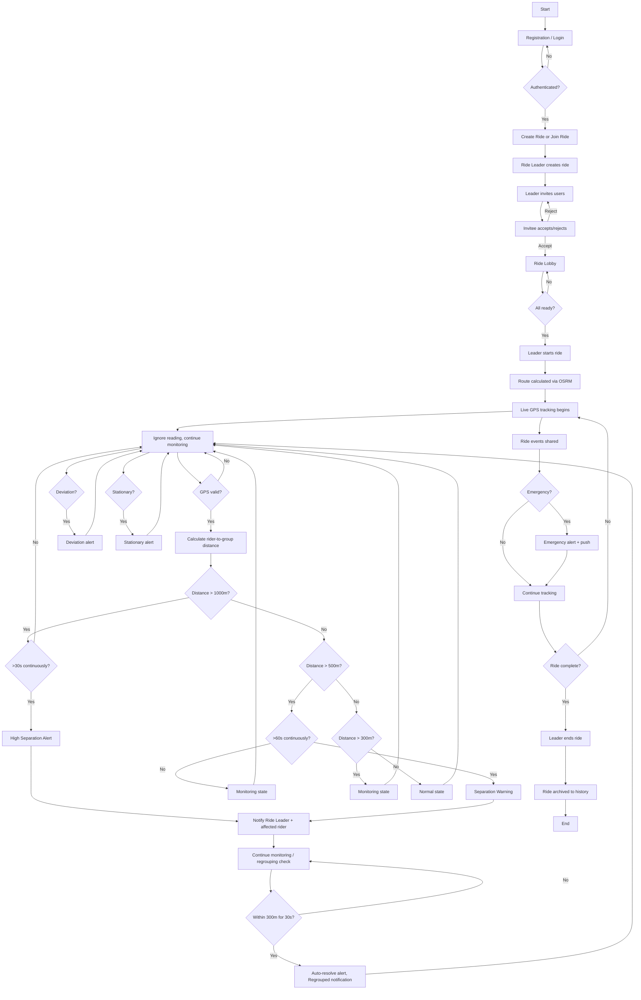

# Section 5: Complete System Workflow

## 5.1 Workflow Sequence (15 Steps)

| Step | Action | Actor | Module |
|------|--------|-------|--------|
| 1 | Registration and login | User | 1 |
| 2 | Ride creation | Ride Leader | 2 |
| 3 | User search and invitation | Ride Leader | 2, 3 |
| 4 | Invitation acceptance or rejection | Invitee | 3 |
| 5 | Ride lobby | All participants | 4 |
| 6 | Ride start | Ride Leader | 4 |
| 7 | Route calculation | System | 6 |
| 8 | Live GPS tracking | All participants | 5 |
| 9 | Intelligent monitoring (separation detection) | System | 7 |
| 10 | Alert generation (separation warning / high separation / regrouped) | System | 7 |
| 11 | Meeting point recommendation | System + Leader | 8 |
| 12 | Ride event management | Participants | 9 |
| 13 | Emergency reporting | Any participant | 10 |
| 14 | Ride completion | Ride Leader | 13 |
| 15 | Ride history | Participants | 13 |

## 5.2 Flowchart (Mermaid)

## 5.3 Detailed Step Explanations

**Step 1 — Registration and Login:** User registers with email/password/phone or logs in. Backend issues JWT access + refresh tokens. Frontend stores tokens securely.

**Step 2 — Ride Creation:** Ride Leader fills ride form (name, start, destination, departure time). Backend creates ride record with `status='planned'`, assigns leader, generates invitation code.

**Step 3 — User Search and Invitation:** Leader searches registered users, selects invitees. Backend creates invitation records with UUID tokens (24h expiry). Invitees notified via WebSocket/push.

**Step 4 — Invitation Acceptance/Rejection:** Invitee responds. Accepted → participant record created (`role='participant'`). Rejected → invitation marked rejected.

**Step 5 — Ride Lobby:** Participants view ride details and member list. Leader can approve/remove participants. Lobby shows readiness status.

**Step 6 — Ride Start:** Leader starts ride. `status='active'`, `started_at` set. WebSocket broadcast to all participants. Location sharing begins.

**Step 7 — Route Calculation:** Backend queries OSRM for polyline, distance, ETA between start and destination. Route stored in `ride_routes`. Displayed on map.

**Step 8 — Live GPS Tracking:** Frontend acquires GPS (5–10s foreground, 30–60s background). Sends updates via WebSocket. Backend validates GPS accuracy (≤ 30 m) and timestamp freshness. Backend broadcasts to ride group. Map markers update.

**Step 9 — Intelligent Monitoring (Separation Detection):** Backend monitoring service runs every 30 seconds. For each active participant:
- Validates GPS accuracy (≤ 30 m) and timestamp freshness (< 2 min).
- Calculates group reference position from active participants' locations.
- Calculates rider-to-group distance using Haversine/PostGIS.
- Classifies rider: Normal (0–300 m), Monitoring (300–500 m), Separation Warning candidate (> 500 m), High Separation candidate (> 1,000 m).
- Manages confirmation timers (60s for separation warning, 30s for high separation).
- Resets/pauses timers when rider returns below threshold.

**Step 10 — Alert Generation:** When confirmation duration is met:
- Separation Warning: rider > 500 m for 60 continuous seconds → alert generated, broadcast to Ride Leader + affected rider, push notification.
- High Separation Alert: rider > 1,000 m for 30 continuous seconds → alert generated, broadcast to Ride Leader + affected rider, high-priority push notification.
- Regrouped: separated rider returns within 300 m for 30 continuous seconds → alert auto-resolved, regrouped notification sent.

**Step 11 — Meeting Point Recommendation:** On separation, backend queries Overpass for nearby POIs, calculates OSRM routes/ETAs from each participant, ranks candidates. Top candidate sent to leader for approval.

**Step 12 — Ride Event Management:** Participants create events (fuel, food, rest). Events broadcast via WebSocket, shown on map and event list.

**Step 13 — Emergency Reporting:** Any participant reports emergency/breakdown. Immediate WebSocket broadcast + high-priority push notification. Status lifecycle tracked.

**Step 14 — Ride Completion:** Leader ends ride. `status='completed'`, `ended_at` set. WebSocket broadcast ride ended. Location sharing stops.

**Step 15 — Ride History:** Participants view completed ride details: duration, participants, events, alerts, route.
