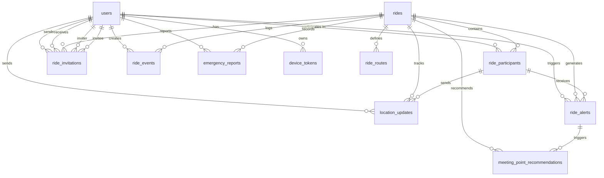

# Section 8: Complete Database Design

## 8.1 Design Principles

- Normalized to 3NF
- PostgreSQL + PostGIS for spatial data
- `geography` type for points (SRID 4326), `geometry` for route linestrings
- UUID primary keys (distributed-safe)
- Soft deletes via `is_active` / `deleted_at` where appropriate
- Cascading: ride deletion cascades to participants, invitations, alerts, events, routes; user deletion protected (ride history preserved)

## 8.2 Entity Relationship Diagram (Mermaid)



## 8.3 Data Dictionary

### Table: users

| Column | Type | Nullable | Default | Constraint | Description |
|--------|------|----------|---------|------------|-------------|
| id | UUID | No | gen_random_uuid() | PK | Primary key |
| email | VARCHAR(255) | No | — | UNIQUE | User email |
| password_hash | VARCHAR(255) | No | — | — | bcrypt/Argon2 hash |
| phone | VARCHAR(20) | Yes | — | — | E.164 format |
| first_name | VARCHAR(100) | Yes | — | — | |
| last_name | VARCHAR(100) | Yes | — | — | |
| profile_picture_url | TEXT | Yes | — | — | |
| emergency_contact_name | VARCHAR(100) | Yes | — | — | |
| emergency_contact_phone | VARCHAR(20) | Yes | — | — | |
| is_active | BOOLEAN | No | TRUE | — | Account active |
| email_verified | BOOLEAN | No | FALSE | — | |
| created_at | TIMESTAMPTZ | No | now() | — | |
| updated_at | TIMESTAMPTZ | No | now() | — | |

**Indexes:** `users_email_idx` (UNIQUE), `users_created_at_idx`

### Table: rides

| Column | Type | Nullable | Default | Constraint | Description |
|--------|------|----------|---------|------------|-------------|
| id | UUID | No | gen_random_uuid() | PK | Primary key |
| name | VARCHAR(200) | No | — | — | Ride name |
| leader_id | UUID | No | — | FK → users.id | Ride leader |
| start_lat | DOUBLE PRECISION | No | — | CHECK -90 to 90 | Start latitude |
| start_lng | DOUBLE PRECISION | No | — | CHECK -180 to 180 | Start longitude |
| start_address | VARCHAR(500) | Yes | — | — | Start address |
| dest_lat | DOUBLE PRECISION | No | — | CHECK -90 to 90 | Destination latitude |
| dest_lng | DOUBLE PRECISION | No | — | CHECK -180 to 180 | Destination longitude |
| dest_address | VARCHAR(500) | Yes | — | — | Destination address |
| departure_time | TIMESTAMPTZ | Yes | — | — | Planned departure |
| status | VARCHAR(20) | No | 'planned' | CHECK planned/active/completed/cancelled | Ride status |
| created_at | TIMESTAMPTZ | No | now() | — | |
| started_at | TIMESTAMPTZ | Yes | — | — | |
| ended_at | TIMESTAMPTZ | Yes | — | — | |

**Indexes:** `rides_leader_id_idx`, `rides_status_idx`, `rides_created_at_idx`

**Foreign Key:** `rides_leader_id_fkey` → users(id) ON DELETE PROTECT

**Cascading:** ON DELETE CASCADE to ride_participants, ride_invitations, ride_routes, ride_alerts, meeting_point_recommendations, ride_events, emergency_reports

### Table: ride_participants

| Column | Type | Nullable | Default | Constraint | Description |
|--------|------|----------|---------|------------|-------------|
| id | UUID | No | gen_random_uuid() | PK | |
| ride_id | UUID | No | — | FK → rides.id | |
| user_id | UUID | No | — | FK → users.id | |
| role | VARCHAR(20) | No | 'participant' | CHECK leader/participant | Ride-specific role |
| status | VARCHAR(20) | No | 'joined' | CHECK joined/left | Participation status |
| separation_status | VARCHAR(30) | No | 'normal' | CHECK normal/monitoring/separation_warning/high_separation/regrouped | Current separation classification |
| separation_distance | DOUBLE PRECISION | Yes | — | meters | Last measured distance from group |
| separation_timer_started_at | TIMESTAMPTZ | Yes | — | — | When confirmation timer started |
| regrouping_timer_started_at | TIMESTAMPTZ | Yes | — | — | When regrouping confirmation timer started |
| joined_at | TIMESTAMPTZ | No | now() | — | |
| left_at | TIMESTAMPTZ | Yes | — | — | |
| is_active | BOOLEAN | No | TRUE | — | Currently in ride |

**Indexes:** `rp_ride_id_idx`, `rp_user_id_idx`, `rp_ride_user_unique_idx` (UNIQUE on ride_id + user_id), `rp_separation_status_idx`

**Foreign Keys:** ON DELETE CASCADE both

### Table: ride_invitations

| Column | Type | Nullable | Default | Constraint | Description |
|--------|------|----------|---------|------------|-------------|
| id | UUID | No | gen_random_uuid() | PK | |
| ride_id | UUID | No | — | FK → rides.id | |
| inviter_id | UUID | No | — | FK → users.id | Leader who sent |
| invitee_id | UUID | No | — | FK → users.id | User invited |
| token | UUID | No | gen_random_uuid() | UNIQUE | Single-use token |
| status | VARCHAR(20) | No | 'pending' | CHECK pending/accepted/rejected/expired | |
| expires_at | TIMESTAMPTZ | No | — | — | 24h from creation |
| created_at | TIMESTAMPTZ | No | now() | — | |
| responded_at | TIMESTAMPTZ | Yes | — | — | |

**Indexes:** `ri_token_idx` (UNIQUE), `ri_ride_id_idx`, `ri_invitee_id_idx`, `ri_expires_at_idx`

**Foreign Keys:** ON DELETE CASCADE

### Table: location_updates

| Column | Type | Nullable | Default | Constraint | Description |
|--------|------|----------|---------|------------|-------------|
| id | UUID | No | gen_random_uuid() | PK | |
| ride_id | UUID | No | — | FK → rides.id | |
| user_id | UUID | No | — | FK → users.id | |
| location | geography(Point,4326) | No | — | — | PostGIS point |
| accuracy | DOUBLE PRECISION | Yes | — | meters | GPS accuracy |
| speed | DOUBLE PRECISION | Yes | — | m/s | |
| heading | DOUBLE PRECISION | Yes | — | degrees | |
| recorded_at | TIMESTAMPTZ | No | — | — | Device timestamp |
| server_received_at | TIMESTAMPTZ | No | now() | — | |

**Indexes:** `lu_ride_user_time_idx` (ride_id, user_id, recorded_at DESC), `lu_location_gist` (GIST on location)

**Retention:** Latest location per user per ride kept; older records purged per retention policy (NFR-010/011)

### Table: ride_routes

| Column | Type | Nullable | Default | Constraint | Description |
|--------|------|----------|---------|------------|-------------|
| id | UUID | No | gen_random_uuid() | PK | |
| ride_id | UUID | No | — | UNIQUE, FK → rides.id | One route per ride |
| geometry | geometry(LineString,4326) | No | — | — | Route polyline |
| distance_m | DOUBLE PRECISION | No | — | meters | |
| duration_s | INTEGER | No | — | seconds | |
| created_at | TIMESTAMPTZ | No | now() | — | |

**Indexes:** `rr_geometry_gist` (GIST on geometry)

**Foreign Key:** ON DELETE CASCADE

### Table: ride_alerts

| Column | Type | Nullable | Default | Constraint | Description |
|--------|------|----------|---------|------------|-------------|
| id | UUID | No | gen_random_uuid() | PK | |
| ride_id | UUID | No | — | FK → rides.id | |
| user_id | UUID | Yes | — | FK → users.id | Participant involved |
| type | VARCHAR(30) | No | — | CHECK separation_warning/high_separation/regrouped/deviation/stationary | Alert type |
| severity | VARCHAR(20) | No | 'warning' | CHECK warning/high/info | Alert severity |
| detected_distance | DOUBLE PRECISION | Yes | — | meters | Distance from group at detection |
| message | TEXT | Yes | — | — | Alert message |
| location_lat | DOUBLE PRECISION | Yes | — | — | Alert location latitude |
| location_lng | DOUBLE PRECISION | Yes | — | — | Alert location longitude |
| status | VARCHAR(20) | No | 'active' | CHECK active/resolved | Alert status |
| created_at | TIMESTAMPTZ | No | now() | — | |
| resolved_at | TIMESTAMPTZ | Yes | — | — | |
| resolved_by | UUID | Yes | — | FK → users.id | |

**Indexes:** `ra_ride_id_idx`, `ra_status_idx`, `ra_type_idx`, `ra_user_id_idx`

**Foreign Keys:** ON DELETE CASCADE

### Table: meeting_point_recommendations

| Column | Type | Nullable | Default | Constraint | Description |
|--------|------|----------|---------|------------|-------------|
| id | UUID | No | gen_random_uuid() | PK | |
| ride_id | UUID | No | — | FK → rides.id | |
| alert_id | UUID | Yes | — | FK → ride_alerts.id | Source alert |
| name | VARCHAR(200) | No | — | — | POI name |
| type | VARCHAR(50) | No | — | — | fuel/restaurant/parking |
| lat | DOUBLE PRECISION | No | — | CHECK -90 to 90 | |
| lng | DOUBLE PRECISION | No | — | CHECK -180 to 180 | |
| address | VARCHAR(500) | Yes | — | — | |
| rank_score | DOUBLE PRECISION | No | — | — | Ranking score |
| max_eta_s | INTEGER | No | — | — | Worst-case ETA seconds |
| status | VARCHAR(20) | No | 'pending' | CHECK pending/approved/rejected/expired | |
| created_at | TIMESTAMPTZ | No | now() | — | |
| expires_at | TIMESTAMPTZ | No | — | — | |
| approved_by | UUID | Yes | — | FK → users.id | Leader |
| approved_at | TIMESTAMPTZ | Yes | — | — | |

**Indexes:** `mpr_ride_id_idx`, `ra_status_idx`, `mpr_expires_at_idx`

**Foreign Keys:** ON DELETE CASCADE

### Table: ride_events

| Column | Type | Nullable | Default | Constraint | Description |
|--------|------|----------|---------|------------|-------------|
| id | UUID | No | gen_random_uuid() | PK | |
| ride_id | UUID | No | — | FK → rides.id | |
| user_id | UUID | No | — | FK → users.id | Creator |
| type | VARCHAR(30) | No | — | CHECK fuel/food/rest/breakdown/other | |
| location_lat | DOUBLE PRECISION | No | — | — | |
| location_lng | DOUBLE PRECISION | No | — | — | |
| address | VARCHAR(500) | Yes | — | — | |
| note | TEXT | Yes | — | — | |
| planned_time | TIMESTAMPTZ | Yes | — | — | |
| status | VARCHAR(20) | No | 'planned' | CHECK planned/completed/cancelled | |
| created_at | TIMESTAMPTZ | No | now() | — | |
| completed_at | TIMESTAMPTZ | Yes | — | — | |

**Indexes:** `re_ride_id_idx`, `re_type_idx`, `re_status_idx`

**Foreign Keys:** ON DELETE CASCADE

### Table: emergency_reports

| Column | Type | Nullable | Default | Constraint | Description |
|--------|------|----------|---------|------------|-------------|
| id | UUID | No | gen_random_uuid() | PK | |
| ride_id | UUID | No | — | FK → rides.id | |
| user_id | UUID | No | — | FK → users.id | Reporter |
| type | VARCHAR(20) | No | — | CHECK breakdown/emergency | |
| severity | VARCHAR(10) | No | 'high' | CHECK low/medium/high/critical | |
| description | TEXT | Yes | — | — | |
| location_lat | DOUBLE PRECISION | No | — | — | |
| location_lng | DOUBLE PRECISION | No | — | — | |
| status | VARCHAR(20) | No | 'active' | CHECK active/acknowledged/resolved/false_alarm | |
| created_at | TIMESTAMPTZ | No | now() | — | |
| acknowledged_at | TIMESTAMPTZ | Yes | — | — | |
| resolved_at | TIMESTAMPTZ | Yes | — | — | |
| resolved_by | UUID | Yes | — | FK → users.id | |

**Indexes:** `er_ride_id_idx`, `er_status_idx`, `er_severity_idx`

**Foreign Keys:** ON DELETE CASCADE

### Table: device_tokens

| Column | Type | Nullable | Default | Constraint | Description |
|--------|------|----------|---------|------------|-------------|
| id | UUID | No | gen_random_uuid() | PK | |
| user_id | UUID | No | — | FK → users.id | |
| token | TEXT | No | UNIQUE | — | FCM/Expo token |
| platform | VARCHAR(10) | No | — | CHECK ios/android | |
| created_at | TIMESTAMPTZ | No | now() | — | |
| last_used_at | TIMESTAMPTZ | Yes | — | — | |

**Indexes:** `dt_user_id_idx`, `dt_token_idx` (UNIQUE)

**Foreign Key:** ON DELETE CASCADE

### Table: notifications (optional — notification history)

| Column | Type | Nullable | Default | Constraint | Description |
|--------|------|----------|---------|------------|-------------|
| id | UUID | No | gen_random_uuid() | PK | |
| user_id | UUID | No | — | FK → users.id | |
| ride_id | UUID | Yes | — | FK → rides.id | |
| type | VARCHAR(30) | No | — | — | |
| title | VARCHAR(200) | No | — | — | |
| body | TEXT | No | — | — | |
| data | JSONB | Yes | — | — | Extra payload |
| read_at | TIMESTAMPTZ | Yes | — | — | |
| created_at | TIMESTAMPTZ | No | now() | — | |

**Indexes:** `n_user_id_idx`, `n_created_at_idx`

## 8.4 Relationship Summary

| Relationship | Type | Cardinality | FK Column |
|--------------|------|-------------|-----------|
| users → ride_participants | One-to-Many | 1:N | ride_participants.user_id |
| rides → ride_participants | One-to-Many | 1:N | ride_participants.ride_id |
| users → ride_invitations (inviter) | One-to-Many | 1:N | ride_invitations.inviter_id |
| users → ride_invitations (invitee) | One-to-Many | 1:N | ride_invitations.invitee_id |
| rides → ride_invitations | One-to-Many | 1:N | ride_invitations.ride_id |
| rides → location_updates | One-to-Many | 1:N | location_updates.ride_id |
| users → location_updates | One-to-Many | 1:N | location_updates.user_id |
| rides → ride_routes | One-to-One | 1:1 | ride_routes.ride_id (UNIQUE) |
| rides → ride_alerts | One-to-Many | 1:N | ride_alerts.ride_id |
| users → ride_alerts | One-to-Many | 1:N | ride_alerts.user_id |
| ride_alerts → meeting_point_recommendations | One-to-Many | 1:N | meeting_point_recommendations.alert_id |
| rides → meeting_point_recommendations | One-to-Many | 1:N | meeting_point_recommendations.ride_id |
| rides → ride_events | One-to-Many | 1:N | ride_events.ride_id |
| users → ride_events | One-to-Many | 1:N | ride_events.user_id |
| rides → emergency_reports | One-to-Many | 1:N | emergency_reports.ride_id |
| users → emergency_reports | One-to-Many | 1:N | emergency_reports.user_id |
| users → device_tokens | One-to-Many | 1:N | device_tokens.user_id |
| users → notifications | One-to-Many | 1:N | notifications.user_id |
| rides → notifications | One-to-Many | 1:N | notifications.ride_id |

## 8.5 PostGIS Geography Strategy

- **location_updates.location**: `geography(Point, 4326)` — supports `ST_Distance` for proximity queries in meters
- **ride_routes.geometry**: `geometry(LineString, 4326)` — route polyline storage
- **Spatial indexes**: GiST on `location_updates.location` and `ride_routes.geometry`
- **SRID**: 4326 (WGS84) for all geographic data

## 8.6 Location Retention Strategy

| Data | Retention | Deletion Method |
|------|-----------|-----------------|
| Active ride location updates | Latest per user per ride only | Overwrite on new update |
| Completed ride locations | 90 days | Scheduled cleanup job |
| Ride history metadata | Indefinite | Manual archive |
| Alerts, events, emergencies | 90 days | Scheduled cleanup |

**Rationale:** Storing every GPS point indefinitely causes rapid DB growth. For active rides, only the latest location per participant is needed for map display. Historical route data for completed rides is summarized (route polyline + stats) rather than raw point-by-point storage.

## 8.7 Separation Threshold Configuration

Separation thresholds are stored as application configuration (not database tables) to allow runtime adjustment without schema changes. Initial values:

| Parameter | Initial Value | Configurable |
|-----------|--------------|--------------|
| Normal distance | 0–300 m | Yes |
| Monitoring distance | 300–500 m | Yes |
| Separation Warning threshold | 500 m | Yes |
| Separation Warning confirmation duration | 60 seconds | Yes |
| High Separation threshold | 1,000 m | Yes |
| High Separation confirmation duration | 30 seconds | Yes |
| GPS accuracy requirement | ≤ 30 metres | Yes |
| Regrouping threshold | 300 m | Yes |
| Regrouping confirmation duration | 30 seconds | Yes |
| Location freshness threshold | < 2 minutes | Yes |

**Implementation note:** Thresholds stored in environment variables or application settings file. Changes require application restart but no database migration.

## 8.7 Database Transaction Requirements

- Ride creation: create ride + create leader participant record (atomic)
- Invitation acceptance: create participant + update invitation status (atomic)
- Ride start: update ride status + broadcast (atomic within request)
- Alert resolution: update alert status + resolved_by + resolved_at (atomic)
- Meeting point approval: update recommendation status + approved_by + approved_at (atomic)
- Emergency report: create report + trigger push + WebSocket (create in transaction, notifications after commit)

## 8.8 Sample Records

**users:**
```json
{
  "id": "550e8400-e29b-41d4-a716-446655440000",
  "email": "alice@example.com",
  "password_hash": "$2b$12$...",
  "phone": "+1234567890",
  "first_name": "Alice",
  "last_name": "Smith",
  "is_active": true,
  "email_verified": true
}
```

**rides:**
```json
{
  "id": "660e8400-e29b-41d4-a716-446655440001",
  "name": "Weekend Trip",
  "leader_id": "550e8400-e29b-41d4-a716-446655440000",
  "start_lat": 40.7128,
  "start_lng": -74.0060,
  "dest_lat": 40.7589,
  "dest_lng": -73.9851,
  "status": "planned"
}
```

**location_updates (PostGIS):**
```sql
INSERT INTO location_updates (ride_id, user_id, location, accuracy, speed, recorded_at)
VALUES (
  '660e8400-...',
  '550e8400-...',
  ST_SetSRID(ST_MakePoint(-74.0060, 40.7128), 4326)::geography,
  5.0, 12.5, NOW()
);
```

## 8.9 Django Model Mapping

Each table maps to a Django model in `rides/` app:
- `User` (extends AbstractUser or custom) → `users`
- `Ride` → `rides`
- `RideParticipant` → `ride_participants`
- `RideInvitation` → `ride_invitations`
- `LocationUpdate` → `location_updates`
- `RideRoute` → `ride_routes`
- `RideAlert` → `ride_alerts`
- `MeetingPointRecommendation` → `meeting_point_recommendations`
- `RideEvent` → `ride_events`
- `EmergencyReport` → `emergency_reports`
- `DeviceToken` → `device_tokens`
- `Notification` → `notifications`

PostGIS fields use `django.contrib.gis.db.models.fields.PointField(geography=True)` and `LineStringField`.

## 8.10 Migration Considerations

- Enable PostGIS extension in migration: `CREATE EXTENSION IF NOT EXISTS postgis;`
- UUID primary keys require `pgcrypto` extension (`gen_random_uuid()`)
- Initial migration creates all tables with constraints
- Spatial indexes created via `GIST` index in Django `Meta.indexes`
- Data retention cleanup via Django management command (cron/celery beat)
