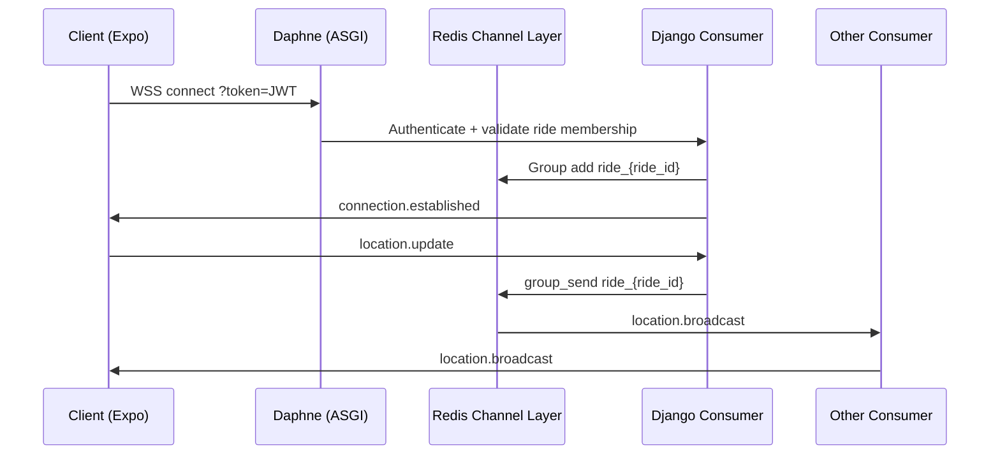

# Section 10: WebSocket and Real-Time Communication Design

## 10.1 Architecture



- **ASGI:** Django Channels + Daphne
- **Channel layer:** Redis (`channels_redis`)
- **Connection URL:** `wss://api.rydlink.com/ws/rides/{ride_id}/`
- **Authentication:** JWT passed as query param `?token=<access_token>` or in `Sec-WebSocket-Protocol` header; validated on connect

## 10.2 Connection Flow

1. Client opens WebSocket to `wss://api.rydlink.com/ws/rides/{ride_id}/?token=<jwt>`
2. Consumer validates JWT, verifies user is active member of ride
3. If authorized: joins channel group `ride_{ride_id}`, sends `connection.established`
4. If unauthorized: closes with code 4003

## 10.3 Message Formats

All messages are JSON with `type` and `payload` fields.

### Client → Server

```json
// Location update
{
  "type": "location.update",
  "payload": {
    "ride_id": "660e8400-...",
    "lat": 40.7128,
    "lng": -74.0060,
    "accuracy": 5.0,
    "speed": 12.5,
    "heading": 90.0,
    "recorded_at": "2024-02-15T08:05:00Z"
  }
}

// Heartbeat/ping
{
  "type": "ping",
  "payload": {}
}
```

### Server → Client

**Connection established:**
```json
{
  "type": "connection.established",
  "payload": { "ride_id": "...", "user_id": "...", "role": "leader" }
}
```

**Location broadcast:**
```json
{
  "type": "location.broadcast",
  "payload": {
    "user_id": "550e8400-...",
    "user_name": "Alice Smith",
    "lat": 40.7128,
    "lng": -74.0060,
    "accuracy": 5.0,
    "speed": 12.5,
    "recorded_at": "2024-02-15T08:05:00Z"
  }
}
```

**Separation Warning:**
```json
{
  "type": "separation.warning",
  "payload": {
    "alert_id": "...",
    "type": "separation_warning",
    "severity": "warning",
    "user_id": "...",
    "user_name": "...",
    "detected_distance": 550.0,
    "message": "Rider has separated from the group (550m)",
    "location": { "lat": 40.7128, "lng": -74.0060 },
    "created_at": "2024-02-15T08:10:00Z"
  }
}
```

**High Separation Alert:**
```json
{
  "type": "separation.high",
  "payload": {
    "alert_id": "...",
    "type": "high_separation",
    "severity": "high",
    "user_id": "...",
    "user_name": "...",
    "detected_distance": 1200.0,
    "message": "High separation alert: Rider 1200m from group",
    "location": { "lat": 40.7128, "lng": -74.0060 },
    "created_at": "2024-02-15T08:10:00Z"
  }
}
```

**Regrouping Notification:**
```json
{
  "type": "separation.regrouped",
  "payload": {
    "alert_id": "...",
    "type": "regrouped",
    "user_id": "...",
    "user_name": "...",
    "detected_distance": 200.0,
    "message": "Rider has regrouped with the group (200m)",
    "location": { "lat": 40.7128, "lng": -74.0060 },
    "resolved_at": "2024-02-15T08:15:00Z"
  }
}
```

**Monitoring State Update (periodic):**
```json
{
  "type": "separation.status.update",
  "payload": {
    "user_id": "...",
    "separation_status": "monitoring",
    "detected_distance": 400.0,
    "message": "Rider is being monitored (400m from group)"
  }
}
```

**Monitoring State Update (periodic):**
```json
{
  "type": "separation.status.update",
  "payload": {
    "user_id": "...",
    "separation_status": "monitoring",
    "detected_distance": 400.0,
    "message": "Rider is being monitored (400m from group)"
  }
}
```

**Meeting point recommendation:**
```json
{
  "type": "meeting-point.recommended",
  "payload": {
    "recommendation_id": "...",
    "name": "Shell Gas Station",
    "type": "fuel",
    "lat": 40.7200,
    "lng": -74.0100,
    "max_eta_s": 600,
    "status": "pending",
    "expires_at": "2024-02-15T08:20:00Z"
  }
}
```

**Meeting point approved:**
```json
{
  "type": "meeting-point.approved",
  "payload": {
    "recommendation_id": "...",
    "approved_by": "...",
    "approved_at": "2024-02-15T08:12:00Z"
  }
}
```

**Ride event:**
```json
{
  "type": "event.new",
  "payload": {
    "event_id": "...",
    "type": "fuel_stop",
    "user_id": "...",
    "user_name": "Bob Jones",
    "location": { "lat": 40.7200, "lng": -74.0100 },
    "note": "Refueling",
    "created_at": "2024-02-15T08:15:00Z"
  }
}
```

**Emergency:**
```json
{
  "type": "emergency.new",
  "payload": {
    "emergency_id": "...",
    "type": "breakdown",
    "severity": "high",
    "user_id": "...",
    "user_name": "Carol White",
    "location": { "lat": 40.7200, "lng": -74.0100 },
    "description": "Flat tire",
    "created_at": "2024-02-15T08:20:00Z"
  }
}
```

**Ride started/ended:**
```json
{
  "type": "ride.started",
  "payload": { "ride_id": "...", "started_at": "..." }
}
{
  "type": "ride.ended",
  "payload": { "ride_id": "...", "ended_at": "..." }
}
```

**Participant joined/left:**
```json
{
  "type": "participant.joined",
  "payload": { "user_id": "...", "user_name": "...", "role": "participant" }
}
{
  "type": "participant.left",
  "payload": { "user_id": "...", "user_name": "..." }
}
```

**Error:**
```json
{
  "type": "error",
  "payload": { "code": "invalid_location", "message": "..." }
}
```

## 10.4 Unauthorized Access Prevention

1. JWT validated on every WebSocket connect (Django Channels `AuthMiddlewareStack` + custom middleware)
2. User must be an active `ride_participants` record for the target ride_id
3. Channel group name is `ride_{ride_id}`; only authorized consumers join
4. Invalid/expired token → connection closed with code 4003, no group join
5. Message validation: `ride_id` in payload must match connected ride group

## 10.5 Reconnection Handling

- Client detects disconnect (WebSocket `onclose`)
- Exponential backoff reconnect (1s, 2s, 4s, 8s, max 30s)
- On reconnect: re-authenticate, rejoin ride group, request latest locations via REST
- Server marks disconnected; after 5 min no update → participant shown as stale/offline

## 10.6 Disconnect Handling

- Consumer `disconnect` → leaves channel group `ride_{ride_id}`
- Server broadcasts `participant.left` to remaining members
- Location updates from disconnected user stop; last known location retained with timestamp
